# Alur Kerja User — AI Motion Studio

Panduan praktis ini menjelaskan alur produksi video **dari sudut pandang Anda sebagai pembuat/pemilik proyek** (*user*). Semua detail teknis di balik layar ditangani otomatis mengikuti SOP di [.agents/skills/motion-studio-workflow/SKILL.md](.agents/skills/motion-studio-workflow/SKILL.md).

---

## 1. Mulai Cepat (1 Chat Baru = 1 Proyek Bersih)

- **Buka percakapan (chat) baru** setiap memulai proyek video baru (`projects/01-...`, `projects/02-...`, dst.) agar konteks tetap bersih dan **tidak mencontek gaya atau karakter proyek sebelumnya**.
- **Mulai dari ide mentah 1–2 kalimat** maupun dokumen/artikel/referensi video — Anda **tidak perlu menulis naskah VO dari nol**.
- **Durasi dan rasio TIDAK wajib diisi manual di awal:** Jika belum disebutkan, agent menanyakannya di sesi Grill Me #4 bersama rekomendasi yang pas. Jika sudah disebutkan sejak awal, tidak akan ditanyakan ulang.
- **Contoh pesan pembuka:**
  > *"Gunakan `/motion-studio-workflow`. Saya ingin membuat video explainer tentang [topik] untuk [audiens] *(opsional: ~60 detik, rasio 9:16)*. Bahan yang sudah ada: [URL / file / catatan poin / aset logo]."*

---

## 2. Gambaran Alur Kerja Studio

```mermaid
flowchart TD
    U1["1. Buka Chat Baru<br/>Panggil /motion-studio-workflow + kirim ide/bahan"] --> A1["Agent: Subagent research susun FACTS.md (<= 5 KB)<br/>Jalankan 4 Sesi Grill Me Terpisah (HANYA di awal!)"]
    A1 --> U2["2. Jawab 4 Sesi Grill Me<br/>1) Konteks · 2) Visual & Subtitle · 3) Audio + BGM/SFX · 4) Output & Thumbnail"]
    U2 --> A2["Agent: Tulis STORYLINES/TREATMENT + baca DEMO.md<br/>+ draf VO frasa ekspresif (Humanizer)"]
    A2 --> U3["3. GATE #1 (Chat Biasa)<br/>Pilih struktur cerita & setujui draf naskah VO"]
    U3 --> A3["Agent: Gemini TTS utama / Edge fallback (tts_expressive.py)<br/>+ nyalakan localhost/audition & hyperlink audition.wav"]
    A3 --> U4["4. Mini-Gate Audisi Audio<br/>Dengar & klik baris kalimat via browser /audition, lalu /compact"]
    U4 --> A4["Agent: Rakit BGM/SFX (mix.py) + Gate #2A Stills<br/>+ Live Preview (pastikan badge out/mix.wav hijau)"]
    A4 --> U5["5. GATE #2A (Stills) -> GATE #2B / #3 (Live Preview)<br/>Revisi pakai Protokol 4-Langkah; cukup Refresh browser!"]
    U5 -->|Revisi diskusi 4-langkah| A4
    U5 -->|Lampu hijau render| A5["Agent: Encode MP4 < 50 MB (-14 LUFS, 48 kHz) + Thumbnail bersih"]
    A5 --> U6["6. Human Audio/Video QA<br/>Tonton & dengarkan langsung file MP4 + cek Thumbnail"]
    U6 -->|Lulus QA| U7["7. Selesai & Dokumentasi<br/>Hapus file mezzanine berat, buat preview/*.jpg (<= 400 KB),<br/>tulis README + 1x local commit (tanya izin sebelum git push)"]
```

---

## 3. Apa yang Anda Lakukan di Setiap Tahap

### Tahap 0 — 4 Sesi Grill Me Terpisah *(Hanya di Awal Proyek)*
Setelah bahan besar disaring oleh subagent `research` menjadi `FACTS.md` (`≤ 5 KB`), agent membuka **4 sesi `/grill-me` terpisah** (ringkas, 1–2 pertanyaan per sesi):
1. **Grill Me #1 — Konteks & Jiwa Konten:** Mengunci tesis utama, sudut pandang (*POV*), **sosok/karakterisasi**, nuansa emosi, dan target audiens.
2. **Grill Me #2 — Visual, Motion & Gaya Subtitle:** Memilih gaya dari 3–4 opsi lengkap dengan **tautan galeri video demo asli (`https://lemomo-ai.github.io/lemo-opuscar/`)**, bentuk karakter (tanpa *stickman* kecuali diminta), gerakan kamera, dan **pilih gaya subtitle *burn-in***:
   - **Short-Form / Viral Captions** *(1–3 kata di area tengah/aman layar, sorotan warna/ukuran kata kunci)*
   - **Kinetic Typography** *(teks bergerak mengikuti ritme suara, beat musik, pop-up/slide/zoom)*
   - **Creative / Stylized Subtitle** *(desain huruf, outline, gradien, glow, atau tekstur sesuai estetika video)*
   - **Tracking / Integrated Subtitle** *(teks menempel pada gerak objek atau karakter di adegan)*
   - *(atau sidecar `.srt` saja tanpa burn-in)*
3. **Grill Me #3 — Audio, VO & Bentuk Delivery BGM/SFX:** Memilih persona suara (**utama: Gemini TTS `gemini-3.8-flash-tts`** dengan fallback otomatis **Edge TTS**, atau rekaman suara sendiri), intonasi retoris/adlib, serta menyepakati **bentuk *delivery* BGM & SFX** *(musik + foley aktif secara default, kecuali Anda secara eksplisit memilih VO murni)*.
4. **Grill Me #4 — Output Akhir, Thumbnail & Mode:** Mengunci rasio & durasi *(jika belum disebut di awal)*, FPS, target ukuran file **`< 50 MB`**, **opsi Thumbnail Publikasi** (*Dedicated Thumbnail `output/<slug>-thumbnail.jpg` bersih tanpa potongan subtitle + Strong First Frame `t=0.0s`*, atau *First Frame saja*), Gate #2, dan persetujuan **Mode A / B / C**.

> Begitu `BRIEF.md` selesai di Tahap 0, **widget Grill Me resmi berakhir**. Seluruh diskusi dari Gate #1 hingga selesai menggunakan **chat biasa**.

### Gate #1 — Pilih Cerita & Setujui Draf VO
- Agent menyajikan `STORYLINES.md` / `TREATMENT.md` (lengkap dengan **Tabel Adaptasi Konteks Anti-Jipling**) + draf `voice/lines.json` (`text` bersih untuk layar vs `say` ber-ekspresi `<short pause>` / pertanyaan retorika `?`).
- **Tugas Anda:** Pilih 1 opsi (atau gabungkan), lalu koreksi istilah, nama resmi, atau angka sebelum suara disintesis.

### Mini-Gate Audisi Audio & Perakitan BGM/SFX
- Agent mensintesis `voice/audition.wav` memakai **Gemini TTS** (atau fallback Edge TTS) dalam 1–2 panggilan agar hemat kuota.
- **Tanpa repot buka folder manual:** Agent memberikan **keduanya** di chat:
  1. **Link Audio Audition Studio (`http://127.0.0.1:3020/audition`)** — putar di browser sambil membaca naskah sinkron, atur kecepatan (`0.75x / 1x / 1.25x`), dan **klik baris kalimat mana saja untuk mengulang bagian tersebut**.
  2. **Hyperlink file langsung (`file:///...`)** ke `voice/audition.wav`.
- Setelah intonasi disetujui, ketik **`/compact`** sebelum masuk ke tahap visual & coding. Lalu agent merakit `mix.py` → `out/mix.wav` (VO + BGM ter-*ducking* `-8 dB` + SFX).

### Gate #2A (Stills) → Gate #2B / #3 (Live Preview Interaktif)
- **Gate #2A (Stills Only):** Agent merender `boards/contact-sheet.jpg` (`0` render video) agar komposisi, ilustrasi, dan teks beres sejak gambar diam.
- **Gate #2B & #3 (Live Preview):** Agent menyalakan Live Preview lokal (`http://127.0.0.1:3020/`). Perhatikan **badge audio di bar atas** — bila BGM/SFX aktif, badge wajib berwarna hijau (**`Audio: out/mix.wav (VO+BGM+SFX)`**). Anda cukup memutar dan **refresh browser** setiap selesai revisi tanpa merender MP4 berulang kali.

### Tahap 6 — Render Final `< 50 MB`, Thumbnail & Human QA
- Agent mengekspor `.mp4` berstandar **`< 50 MB`**, `48 kHz` stereo, **`-14 LUFS`**, 0 frame hitam, disertai cover bersih `output/<slug>-thumbnail.jpg` (sesuai `BRIEF.md`).
- **Tugas Anda:** Tonton & dengarkan `.mp4` final serta cek thumbnail-nya sebelum memberi konfirmasi lulus QA.

### Tahap 7 — Pembersihan & Dokumentasi Git
- Setelah Anda mengonfirmasi lulus QA, agent menghapus file intermediate berat (`out/video.mp4`), mengekspor `preview/poster.jpg` & `preview/contact-sheet.jpg` ringan (`≤ 400 KB`), menulis `projects/NN-slug/README.md`, dan membuat **1x *local git commit***.
- Agent **selalu meminta persetujuan Anda** sebelum `git push` ke GitHub.

---

## 4. Jalur Input Lanjutan: Referensi Video & Artikel

Folder `projects/**/ref/` dan `projects/**/source/` sudah otomatis masuk `.gitignore`, sehingga bahan mentah pihak ketiga aman tersimpan lokal tanpa ikut ter-push ke GitHub publik.

### A. Dari Referensi Motion Video (TikTok / IG / FB / YouTube)
- **Cara paling stabil:** Simpan video di `projects/NN-slug/ref/ref.mp4` dan sebutkan path-nya. Link publik (YouTube/TikTok) dapat dicoba via `yt-dlp`, sedangkan link ber-login wall / anti-bot harus diunduh manual oleh Anda.
- **3 Jalur Lokal 100% Gratis:** *(1) Ambil STYLE saja* (`STYLE_REF.md` + Tabel Anti-Jipling), *(2) Ambil KONTEN saja* (`faster-whisper` → `FACTS.md` + pilih style baru), atau *(3) Adaptasi Keduanya* (ganti bahasa/brand/aset secara orisinal). *(Akurat untuk motion graphics/2D/3D geometris, bukan live-action manusia).*

### B. Dari Tulisan / Artikel Panjang (Medium / Substack / Blog)
- **Cara paling stabil:** Simpan isi artikel ke `projects/NN-slug/source/article.md` (atau *Save as PDF* ke `source/`), plus grafik kunci bila ada. URL publik terbuka boleh ditempel langsung.
- **Alur Distilasi:** Subagent `research` memadatkan artikel menjadi `FACTS.md` (`≤ 5 KB`), lalu pada **Grill Me #4** Anda memilih format (*Single Short `9:16` 45–75 detik*, *Mini-Series*, atau *Explainer Utuh `16:9` 90–150 detik*).

---

## 5. Checklist Input Mandiri Wajib dari Anda

- [ ] **API Key Gemini** *(sudah tersimpan di `.env` lokal yang diabaikan Git — cukup 1 key pribadi tanpa multi-akun; jika perlu diganti, edit file `.env` langsung tanpa menempelkan key di chat).*
- [ ] **Fakta & angka resmi** (nama instansi/produk, data asli, kutipan, URL sumber).
- [ ] **Aset identitas & hak cipta** (logo resmi resolusi tinggi, foto/video internal, font khusus, atau rekaman suara pribadi bila tidak memakai TTS).
- [ ] **Kredensial privat / generator gambar eksternal** *(hanya jika memakai `video-demo` di balik login atau 1 dari 3 gaya bertanda `✦` di Lemo-Opuscar).*
- [ ] **Audisi Audio (`/audition`), Live Preview (`/`), & Human QA (`.mp4` + thumbnail)** serta **izin `git push`**.

---

## 6. Protokol Revisi 4 Langkah (Cepat & Terarah)

Selama produksi dan Live Preview, revisi berjalan lewat **chat biasa** (tanpa widget Grill Me) mengikuti 4 langkah ini:
1. **Anda:** Menyampaikan detail masukan, adegan yang kurang pas, dan efek/rasa yang diinginkan.
2. **Agent *(belum mengedit kode)*:** Mengonfirmasi pemahaman, merangkum akar masalah, dan mengajukan **opsi saran perbaikan** konkret.
3. **Anda:** Memilih opsi atau memberi masukan tambahan sampai sepakat.
4. **Agent:** Mengeksekusi perubahan lalu mengabari Anda untuk me-**refresh Live Preview** di browser.
*(Untuk perintah teknis yang sudah 100% eksplisit tanpa ruang tafsir, misalnya "hapus teks kredit di Scene 6", agent langsung mengeksekusi lalu meminta Anda refresh).*

---

## 7. Tips Manajemen Chat, Kuota & Pemilihan Model

| Kebutuhan Tahap | Rekomendasi Model | Alasan Praktis |
| :--- | :--- | :--- |
| **Tahap 0–1 (Konteks, Story, Art Direction) & Coding Scene Inti** | **Model Pro / High** *(mis. Gemini 4 / Claude Opus/Sonnet)* | Menjaga orisinalitas visual, kepatuhan gaya `DEMO.md`, akting karakter, & *storytelling* tanpa bolak-balik revisi. |
| **Tahap 2, 5, 6, 7 (Eksekusi skrip TTS/Render, Revisi terarah, `README.md`)** | **Model Flash** *(mis. Gemini Flash)* | Jauh lebih hemat token & kuota untuk tugas eksekusi mekanis dan revisi spesifik yang arahnya sudah jelas. |

- Ketik **`/compact`** tepat setelah **Audisi Audio** atau **Gate #2A (Stills)** disetujui agar konteks ringan hingga selesai.
- Jika terjadi **pivot total gaya/engine**, buka **chat baru** membawa `FACTS.md` & `BRIEF.md` yang sudah ada.
