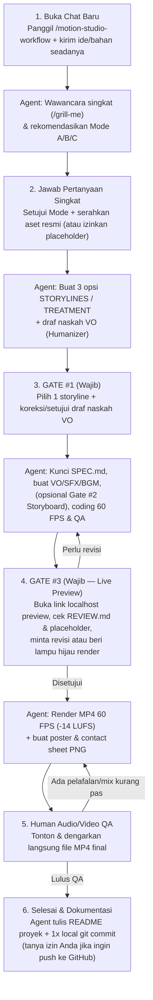

# Alur Kerja User — AI Motion Studio

Panduan praktis ini menjelaskan alur produksi video **dari sudut pandang Anda sebagai pembuat/pemilik proyek** (*user*). Semua detail teknis di balik layar (pembuatan naskah awal, sinkronisasi audio, penulisan kode animasi `60 FPS`, QA visual, dan mastering audio) ditangani otomatis oleh agent sesuai SOP di [.agents/skills/motion-studio-workflow/SKILL.md](.agents/skills/motion-studio-workflow/SKILL.md).

---

## 1. Mulai Cepat (1 Chat Baru = 1 Proyek)

- **Buka percakapan (chat) baru** setiap kali memulai proyek video baru (`projects/01-...`, `projects/02-...`, dst.). Tujuannya agar konteks percakapan bersih dan seluruh skill studio langsung termuat utuh sejak awal.
- **Anda boleh mulai dari ide mentah 1–2 kalimat** maupun dokumen lengkap — Anda **tidak perlu menulis naskah VO dari nol**.
- **Contoh pesan pembuka yang disarankan:**
  > *"Gunakan `/motion-studio-workflow`. Saya ingin membuat video explainer ~60 detik rasio 16:9 tentang [topik] untuk [audiens]. Bahan yang sudah ada: [URL / catatan poin / aset logo]."*

---

## 2. Gambaran Alur Kerja (POV Anda vs Agent)

---

## 3. Apa yang Anda Lakukan di Setiap Titik

### Tahap 0 — Wawancara Singkat (`/grill-me`) & Pilihan Mode
Agent akan mengajukan pertanyaan singkat satu per satu (pilihan ganda dengan opsi rekomendasi di urutan pertama) untuk menyepakati:
- Tujuan video, target audiens, serta bahan/angka/aset resmi yang sudah Anda pegang.
- Jika ada aset/data resmi yang belum siap, Anda bisa mengizinkan agent memakai *labeled placeholder* / angka `[ilustratif]` terlebih dahulu (akan dicek ulang sebelum render final).
- Rasio video (`16:9` landscape atau `9:16` vertikal), target durasi, serta apakah butuh **Gate #2 (Storyboard Visual)** sebelum animasi dibuat.
- Konfirmasi mode engine yang direkomendasikan agent:
  - **Mode A:** HyperFrames (`HTML/CSS + GSAP`) + Audio Suite Lemo-Opuscar.
  - **Mode B:** Lemo-Opuscar Pure (1 dari 99 gaya artistik).
  - **Mode C:** Hybrid (HyperFrames stage + scene Canvas/Three.js/`video-demo` + Audio Suite).

### Gate #1 (Wajib) — Pilih Cerita & Setujui Draf Naskah VO
- Agent menyajikan `STORYLINES.md` (3 opsi cerita yang berbeda *world/device/form*) atau `TREATMENT.md`, plus draf naskah VO (`voice/lines.json`) yang sudah dihaluskan dengan `humanizer`.
- **Tugas Anda:** Pilih 1 opsi (atau gabungkan, mis. *"pembuka A + isi C"*), lalu koreksi istilah, nama resmi, atau angka pada draf VO sebelum TTS direkam.

### Gate #2 *(Opsional)* — Tinjau Storyboard Visual
- Hanya muncul jika Anda memintanya di Tahap 0.
- **Tugas Anda:** Cek *still frames* pada tab **Storyboard** di Preview Studio (Mode A/C) atau lembar grid `sheet.py` (Mode B), lalu beri lampu hijau atau catatan perbaikan komposisi per frame.

### Gate #3 (Wajib) — Live Preview Sebelum Render MP4
- Agent menjalankan audit QA (`check`, `snapshot --review`, `impeccable`), menulis `REVIEW.md`, dan membuka **Live Preview** di browser lokal (`http://localhost:...`).
- **Tugas Anda:**
  1. Buka link `localhost` preview untuk menonton animasi secara langsung (*play/pause*, geser timeline detik demi detik) **tanpa menunggu proses render MP4 penuh**.
  2. Cek kembali daftar *placeholder* / angka `[ilustratif]` yang tercatat di `REVIEW.md` agar tidak ada data sementara yang lolos ke render final.
  3. Minta revisi jika perlu, atau beri izin **"Lanjut render final"**.

### Tahap 6 — Human Audio & Video QA (Pasca-Render)
- Setelah `.mp4` `60 FPS` (`-14 LUFS`) selesai dirender, agent hanya bisa memverifikasi metrik teknis secara terukur (durasi, FPS, level loudness, bebas clipping).
- **Tugas Anda:** Tonton dan dengarkan langsung file `.mp4` final di perangkat Anda — pastikan intonasi pelafalan singkatan/istilah asing tepat, jeda napas nyaman, dan volume musik latar tidak menutupi suara VO.

### Tahap 7 — Penutup & Dokumentasi Git
- Begitu Anda mengonfirmasi hasil `.mp4` final lulus QA, agent otomatis menulis `projects/NN-slug/README.md` (dilengkapi `preview/poster.png` & `preview/contact-sheet.png`), memperbarui tabel portofolio di [README.md](README.md), dan membuat **1x *local git commit***.
- Agent **selalu meminta persetujuan Anda** sebelum menjalankan `git push` ke GitHub.

---

## 4. Checklist Input Mandiri Wajib dari Anda

Hal-hal berikut **hanya bisa datang dari Anda** (agent dilarang mengarang):

- [ ] **Fakta & angka resmi** (nama produk/instansi, statistik asli, daftar fitur aktual, URL sumber).
- [ ] **Aset identitas & hak cipta** (logo resmi resolusi tinggi, foto/video internal, font khusus, atau rekaman suara pribadi bila tidak memakai TTS).
- [ ] **Kredensial akses privat** (jika proyek merekam web app yang butuh login via `video-demo` atau API key eksternal).
- [ ] **Generator gambar eksternal** *(khusus jika di Mode B Anda memilih 1 dari 3 gaya bertanda `✦`: `text-flash-cuts`, `comic-history`, atau `manga-panels`)*.
- [ ] **Human Audio/Video QA** atas file `.mp4` final sebelum proyek dinyatakan selesai.
- [ ] **Konfirmasi `git push`** saat ingin mengunggah dokumentasi proyek ke GitHub.

---

## 5. Cara Memberi Revisi agar Cepat & Tepat

| Tahap | Contoh Catatan Revisi yang Efektif |
| :--- | :--- |
| **Gate #1 (Cerita & VO)** | *"Ambil storyline B, tapi pembukanya pakai gaya A. Di baris VO 04 ubah 'VervalPD' jadi pelafalan 'Verval P D'."* |
| **Gate #2 (Storyboard)** | *"Frame 03 terlalu padat; potong teks bawah dan perbesar angka utamanya."* |
| **Gate #3 (Live Preview)** | *"Di 0:14 transisi masuk terlalu cepat, buat lebih halus. Di scene 03 teks putih di latar terang kurang kontras."* |
| **Human QA (Pasca-Render)** | *"Baris VO ke-5 pelafalannya kepotong dan BGM di segmen tengah agak terlalu keras."* |

---

## 6. Tips Manajemen Percakapan

- Gunakan perintah `/compact` jika satu proyek mengalami sangat banyak putaran revisi hingga percakapan terasa panjang, agar konteks tetap hemat tanpa perlu pindah chat.
- Pastikan seluruh catatan proyek terdokumentasi di `projects/NN-slug/` supaya proyek tetap bisa dilanjutkan di sesi chat baru kapan saja.
