# Alur Kerja User — AI Motion Studio

Panduan praktis ini menjelaskan alur produksi video **dari sudut pandang Anda sebagai pembuat/pemilik proyek** (*user*). Semua detail teknis di balik layar — termasuk pemilihan *engine* optimal secara otomatis — ditangani mengikuti SOP di [.agents/skills/motion-studio-workflow/SKILL.md](.agents/skills/motion-studio-workflow/SKILL.md).

---

## 1. Mulai Cepat (1 Chat Baru = 1 Proyek Bersih)

- **Buka percakapan (chat) baru** setiap memulai proyek video baru (`projects/01-...`, `projects/02-...`, dst.) agar konteks tetap bersih dan **tidak mencontek gaya atau karakter proyek sebelumnya**.
- **Mulai dari ide mentah 1–2 kalimat** maupun dokumen/artikel/referensi video — Anda **tidak perlu menulis naskah VO dari nol**.
- **Durasi, rasio, & engine TIDAK perlu dipikirkan di awal:** Durasi dan rasio ditanyakan di Grill Me #4 hanya jika belum Anda sebutkan, sedangkan **pilihan engine dipilih otomatis oleh agent** berdasarkan gaya visual yang Anda pilih di Grill Me #2.
- **Contoh pesan pembuka:**
  > *"Gunakan `/motion-studio-workflow`. Saya ingin membuat video explainer tentang [topik] untuk [audiens] *(opsional: ~60 detik, rasio 9:16)*. Bahan yang sudah ada: [URL / file / catatan poin / aset logo]."*

---

## 2. Gambaran Alur Kerja Studio

```mermaid
flowchart TD
    U1["1. Buka Chat Baru<br/>Panggil /motion-studio-workflow + kirim ide/bahan"] --> A1["Agent: Subagent research (Flash) susun FACTS.md (<= 5 KB)<br/>Jalankan 4 Sesi Grill Me Terpisah (HANYA di awal!)"]
    A1 --> U2["2. Jawab 4 Sesi Grill Me<br/>1) Konteks · 2) Pilih Gaya Visual & Subtitle (Engine Auto)<br/>3) Audio VO + BGM/SFX · 4) Output, Thumbnail, Watermark & Privasi"]
    U2 --> A2["Agent: Tulis STORYLINES/SPEC atau TREATMENT + DEMO.md<br/>+ draf VO ekspresif (Humanizer)"]
    A2 --> U3["3. GATE #1 (Chat Biasa)<br/>Pilih struktur cerita & setujui draf naskah VO"]
    U3 --> A3["Agent: Gemini TTS + Audio Lock (tts_expressive.py)<br/>+ nyalakan localhost/audition & hyperlink audition.wav"]
    A3 --> U4["4. Mini-Gate Audisi Audio<br/>Dengar via /audition, lalu kirim /compact saja -> Lanjut"]
    U4 --> A4["Agent: Rakit BGM/SFX bed + studio-audit.mjs (~12s)<br/>+ sajikan ONLY Stills Contact Sheet di Gate #2A"]
    A4 --> U5["5. GATE #2A (Stills + /compact) -> Sinkron events.json -> GATE #2B / #3 (Live Preview)<br/>Revisi pakai Protokol 4-Langkah; cukup Refresh browser!"]
    U5 -->|Revisi diskusi 4-langkah| A4
    U5 -->|Lampu hijau render| A5["Agent: Encode MP4 < 50 MB (-14 LUFS, 48 kHz) + Thumbnail bersih"]
    A5 --> U6["6. Human Audio/Video QA<br/>Tonton & dengarkan langsung file MP4 + cek Thumbnail"]
    U6 -->|Lulus QA| U7["7. Selesai & Dokumentasi<br/>Hapus file mezzanine berat, Privacy Scan, preview/*.jpg (<= 400 KB),<br/>tulis README + 1x local commit (tanya izin sebelum git push)"]
```

---

## 3. Apa yang Anda Lakukan di Setiap Tahap

### Tahap 0 — 4 Sesi Grill Me Terpisah *(Hanya di Awal Proyek)*
Jika bahan mentah panjang (repo/artikel/video), subagent `research` (**Model Flash**) menyaringnya terlebih dahulu menjadi `FACTS.md` (`≤ 5 KB`). Setelah itu, agent membuka **4 sesi `/grill-me` terpisah** (ringkas, 1–2 pertanyaan per sesi):
1. **Grill Me #1 — Konteks & Jiwa Konten:** Mengunci tesis utama, sudut pandang (*POV*), **sosok/karakterisasi**, nuansa emosi, dan target audiens.
2. **Grill Me #2 — Gaya Visual, Motion & Subtitle *(Cukup Pilih Gaya)*:** Anda cukup memilih **gaya visual** dari 3–4 opsi lengkap dengan **tautan galeri demo asli (`https://lemomo-ai.github.io/lemo-opuscar/`)**, arah karakter/gerak kamera, dan **1 Gaya Subtitle**:
   - **Short-Form / Viral Captions** *(1–3 kata per grup di zona aman Reels/TikTok `y <= 1360px`, sorot kata kunci, anti-pecah angka & satuan)*
   - **Kinetic Typography** *(teks bergerak ritmis mengikuti suara/beat musik)*
   - **Creative / Stylized Subtitle** *(outline, gradien, stamp, glow sesuai estetika video)*
   - **Tracking / Integrated Subtitle** *(teks menempel pada gerak objek/karakter)*
   - *(atau sidecar `.srt` saja tanpa burn-in)*
   > **Auto-Engine Routing:** Agent otomatis memilih jalur tercepat dan paling pas di balik layar — **Track 1 (`Lemo-Opuscar`)** untuk gaya artistik/esai, **Track 2 (`DOM/GSAP Hybrid`)** untuk editorial UI/web/data tanpa overhead berat, atau **Track 3 (`HyperFrames Lean`)** khusus bila menyematkan rekaman app `video-demo`/`<video>`. Anda tidak perlu memilih istilah teknis engine, namun bebas *override* kapan saja di chat.
3. **Grill Me #3 — Audio, VO & Bentuk Delivery BGM/SFX:** Memilih persona suara (**utama: Gemini TTS `gemini-3.8-flash-tts`** dengan fallback otomatis **Edge TTS**, atau rekaman suara sendiri / tanpa VO), intonasi retoris/adlib, serta **bentuk *delivery* BGM & SFX** *(musik + foley sinkron aktif secara default)*.
4. **Grill Me #4 — Output Akhir, Thumbnail, Watermark & Privasi:** Mengunci rasio & durasi *(jika belum disebut di awal)*, FPS adaptif *(24/30 FPS untuk efisiensi render, atau 60 FPS untuk motion UI/scroll cepat)*, target **`< 50 MB`**, **opsi Thumbnail Publikasi** (*Dedicated Cover bersih tanpa subtitle + Strong First Frame*), **opsi Watermark** (*(Recommended) Tanpa Watermark* sebagai default · *Watermark Akhir Video / End Card Only* · *Watermark Halus Sepanjang Video opacity 18–25%*), serta **Privasi & Sensor** *(apakah ada wajah, NIP, kode QR, atau nama instansi yang harus diblur/disamarkan)*.

> Begitu `BRIEF.md` selesai di Tahap 0, **widget Grill Me resmi berakhir**. Seluruh diskusi dari Gate #1 hingga selesai menggunakan **chat biasa**.

### Gate #1 — Pilih Cerita & Setujui Draf VO
- Agent menyajikan `TREATMENT.md` (**Tabel Anti-Jipling**) atau `STORYLINES.md` + `SPEC.md` disertai draf `voice/lines.json` (`text` layar vs `say` ber-ekspresi `<short pause>`, `<sigh>`, `?`).
- **Tugas Anda:** Pilih opsi alur, lalu koreksi istilah, nama resmi, sensor privasi, atau angka sebelum suara disintesis.

### Mini-Gate Audisi Audio *(Dilengkapi Pengunci Warna Suara / Audio Lock)*
- Agent mensintesis `voice/audition.wav` memakai **Gemini TTS** (atau fallback Edge TTS) termasuk dukungan **Duet 2-Suara**, lalu menyajikan:
  1. **Link Audio Audition Studio (`http://127.0.0.1:3020/audition`)** — klik kalimat mana saja untuk mengulang, ubah speed `0.75x/1x/1.25x`.
  2. **Hyperlink file langsung (`file:///...`)** ke `voice/audition.wav`.
- **Revisi VO Tanpa Merusak Suara Favorit Anda:** Jika warna suara sudah pas dan Anda hanya ingin memperlambat tempo (mis. `0.90x`), menambah jeda antar-shot, atau menghapus/mengedit 1 scene saja, agent memakai **`--tempo`** *(atempo tanpa mengubah pitch/akting suara)* dan cache per-klip **`--reuse-clips`** — jadi scene lain tetap 100% identik suaranya.
- **WAJIB `/compact` Mandiri:** Begitu audio disetujui, kirim **`/compact` saja sebagai pesan terpisah** *(jangan digabung dengan kata lain seperti `"Setuju, /compact"` agar perintah `/compact` terpicu!)*. Proses compaction selesai dalam `< 2 detik`, lalu ketik **`Lanjut`** agar agent merakit musik bed & mengoding visual.

### Gate #2A (Stills Saja + `/compact`) → Gate #2B / #3 (Live Preview Interaktif)
- **Gate #2A (Persetujuan Stills Terpisah):** Agent menjalankan `studio-audit.mjs` (~12–24 detik untuk Track 1/2) atau `check --snapshots` (Track 3) untuk menguji *0 font 404*, *0 *dead-hold* > 2 detik*, *zona aman Reels/TikTok `y <= 1360px` (`y <= 1120px` untuk ilustrasi Canvas)*, *kontras WCAG*, serta menyajikan **HANYA `boards/contact-sheet.jpg`**, `phone-360.jpg`, dan `seams.jpg` — **tautan Live Preview belum dibuka di tahap ini** agar revisi tata letak lebih cepat lewat storyboard/stills.
- **Kirim `/compact` lagi secara mandiri**, lalu ketik **`Lanjut`** setelah Gate #2A disetujui.
- **Sinkron Foley & Gate #2B / #3 (Live Preview):** Jika gaya memakai foley prosedural (seperti coretan pena), agent terlebih dahulu mengekspor `events.json` nyata dari animasi agar SFX sinkron sempurna dengan gambar (2-fase audio), lalu membuka Live Preview (`http://127.0.0.1:3020/`). Pastikan badge bar atas berwarna hijau **`Audio: out/mix.wav (VO+BGM+SFX)`** bila musik/SFX aktif. Cukup **refresh browser** setiap selesai revisi.

### Tahap 6 & 7 — Render Final `< 50 MB`, Thumbnail, Privacy Scan & Git
- Di awal Tahap 6, agent **otomatis mematikan seluruh background daemon preview** sebelum mengekspor `.mp4` **`< 50 MB`** (`yuv420p` TV-range, `48 kHz` stereo, **`-14 LUFS`**, 0 frame hitam) + `output/<slug>-thumbnail.jpg`.
- **Tugas Anda:** Tonton & dengarkan `.mp4` final serta cek thumbnail-nya. Setelah Anda menyatakan **lulus QA**, agent membersihkan file mezzanine berat, menjalankan **Privacy Scan** (memastikan NIP/wajah/nama instansi rahasia tidak bocor), membuat `preview/*.jpg` (`≤ 400 KB`), menulis `README.md`, membuat **1x local commit** (folder `boards/` diabaikan `.gitignore`), dan **meminta izin Anda sebelum `git push`**.

---

## 4. Jalur Input Lanjutan: Referensi Video & Artikel

Folder `projects/**/ref/` dan `projects/**/source/` otomatis masuk `.gitignore`, sehingga bahan mentah lokal tidak ikut ter-push ke GitHub publik.

- **Referensi Video (`ref/ref.mp4`):** Simpan video lokal ke `ref/ref.mp4` (atau tempel URL publik). Tersedia 3 jalur gratis: *Style saja* (`STYLE_REF.md`), *Konten saja* (`faster-whisper` → `FACTS.md`), atau *Adaptasi Keduanya*.
- **Artikel Panjang (`source/article.md`):** Simpan salinan teks/PDF ke `source/`. Subagent `research` (`Flash`) memadatkan ke `FACTS.md` (`≤ 5 KB`), lalu pilih format di Grill Me #4 (*Single Short*, *Mini-Series*, atau *Explainer Utuh*).

---

## 5. Checklist Input Mandiri Wajib dari Anda

- [ ] **API Key Gemini** *(1 key pribadi di `.env` lokal yang diabaikan Git — edit `.env` langsung bila diganti, jangan tempel di chat).*
- [ ] **Fakta, angka resmi, & batas privasi** (hal mana saja yang harus diblur/disamarkan).
- [ ] **Aset identitas & hak cipta** (logo, font khusus, screenshot/rekaman pribadi, atau rekaman suara sendiri).
- [ ] **Kredensial privat / generator gambar eksternal** *(hanya bila memakai `video-demo` di balik login atau gaya bertanda `✦` di Lemo-Opuscar).*
- [ ] **Audisi Audio (`/audition`), Live Preview (`/`), & Human QA (`.mp4` + thumbnail)** serta **izin `git push`**.

---

## 6. Protokol Revisi 4 Langkah (Cepat & Terarah)

Selama produksi dan Live Preview, revisi berjalan lewat **chat biasa** (tanpa widget Grill Me):
1. **Anda:** Menyampaikan bagian yang kurang pas dan hasil yang diharapkan.
2. **Agent *(sebelum menyentuh kode)*:** Mengonfirmasi pemahaman, merangkum akar masalah, **memperingatkan bila opsi berpotensi memicu regenerasi audio**, dan mengajukan **opsi perbaikan konkret**.
3. **Anda:** Memilih opsi atau memberi masukan tambahan sampai sepakat.
4. **Agent:** Mengeksekusi perubahan lalu meminta Anda me-**refresh Live Preview**.
*(Untuk perintah tunggal yang 100% eksplisit tanpa ruang tafsir, agent langsung mengeksekusi lalu meminta Anda refresh).*

---

## 7. Tips Manajemen Chat, Kuota & Pemilihan Model

| Kebutuhan Tahap | Rekomendasi Model | Alasan Praktis |
| :--- | :--- | :--- |
| **Tahap 0–1 (Grill Me, Konsep, *Storytelling*) & Desain Scene Inti** | **Model Pro / High** | Menjaga orisinalitas visual, kepatuhan gaya, akting animasi, & mencegah iterasi revisi berulang. |
| **Subagent `research`, Tahap 2, 5, 6, 7 (TTS/Render/QA/`README.md`) & Revisi Terarah** | **Model Flash** | Menghemat hingga ~60–70% kuota limit 5-jam dan menjaga riset cepat tanpa mengorbankan hasil akhir. |

- **Cara Benar Menggunakan `/compact`:** Kirim **`/compact` saja dalam 1 pesan tersendiri** tepat setelah **Audisi Audio** dan **Gate #2A** disetujui (jangan menulis `"Setuju, /compact"` dalam 1 pesan karena slash command bisa terabaikan). Setelah selesai (`< 2 detik`), ketik **`Lanjut`**. Catatan: bila server **Live Preview** masih menyala (ikon spinner task berputar), hal itu **bukan** tanda `/compact` macet — agent akan mematikan semua server preview otomatis saat masuk Tahap 6.
- Jika terjadi **pivot total gaya**, buka **chat baru** membawa `FACTS.md` & `BRIEF.md` yang sudah ada.
