# Alur Kerja User — AI Motion Studio (v2)

Panduan praktis ini menjelaskan alur produksi video **dari sudut pandang Anda sebagai pembuat/pemilik proyek** (*user*). Semua detail teknis di balik layar (ekstraksi bahan lewat subagent terpisah, penulisan naskah mikro ekspresif, sinkronisasi audio, penulisan kode animasi `60 FPS`, QA visual, dan mastering audio) ditangani otomatis oleh agent sesuai SOP v2 di [.agents/skills/motion-studio-workflow/SKILL.md](.agents/skills/motion-studio-workflow/SKILL.md).

---

## 1. Mulai Cepat (1 Chat Baru = 1 Proyek)

- **Buka percakapan (chat) baru** setiap kali memulai proyek video baru (`projects/01-...`, `projects/02-...`, dst.). Tujuannya agar konteks bersih, kuota hemat, dan seluruh skill studio langsung termuat utuh sejak awal.
- **Anda boleh mulai dari ide mentah 1–2 kalimat** maupun dokumen/kode/referensi lengkap — Anda **tidak perlu menulis naskah VO dari nol**.
- **Durasi dan rasio TIDAK wajib diisi manual di awal:** Jika belum Anda sebutkan di pesan pembuka, agent otomatis menanyakannya saat sesi `/grill-me` (lengkap dengan rekomendasi yang cocok untuk topik/bahan/platform Anda). Sebaliknya, jika sudah Anda tentukan sejak awal, agent tidak akan menanyakannya ulang.
- **Contoh pesan pembuka yang disarankan:**
  > *"Gunakan `/motion-studio-workflow`. Saya ingin membuat video explainer tentang [topik] untuk [audiens] *(opsional: ~60 detik, rasio 9:16)*. Bahan yang sudah ada: [URL / ID file / catatan poin / aset logo]."*

---

## 2. Gambaran Alur Kerja v2 (Hemat Token & Anti-Pivot)

```mermaid
flowchart TD
    U1["1. Buka Chat Baru<br/>Panggil /motion-studio-workflow + kirim ide/bahan seadanya"] --> A1["Agent: Subagent research susun FACTS.md (<= 5 KB)<br/>+ wawancara Style (link galeri video) & Voice Direction"]
    A1 --> U2["2. Jawab Wawancara (/grill-me)<br/>Tonton contoh video gaya, setujui Mode A/B/C & Voice Direction"]
    U2 --> A2["Agent: Buat STORYLINES/TREATMENT + Tabel Anti-Jipling<br/>+ draf VO frasa mikro (Humanizer)"]
    A2 --> U3["3. GATE #1 (Wajib)<br/>Pilih cerita + koreksi/setujui draf naskah VO"]
    U3 --> A3["Agent: Generate VO ekspresif (tts_expressive.py)<br/>-> voice/audition.wav + BGM/SFX"]
    A3 --> U4["4. Mini-Gate Audisi Audio<br/>Dengarkan audition.wav dulu (sebelum animasi dikodekan)"]
    U4 -->|Koreksi intonasi/tempo| A3
    U4 -->|Suara oke & /compact| A4["Agent: Buat Gate #2A Stills (contact-sheet.jpg)<br/>0 render video di tahap ini!"]
    A4 --> U5["5. GATE #2A (Stills) -> GATE #2B / #3 (Live Preview)<br/>Puas dengan gambar diam -> cek gerak + suara via localhost Live Preview"]
    U5 -->|Revisi bentuk / gerak| A4
    U5 -->|Lampu hijau render| A5["Agent: Render MP4 60 FPS (-14 LUFS)<br/>+ buat poster.png & contact-sheet.png"]
    A5 --> U6["6. Human Audio/Video QA<br/>Tonton & dengarkan langsung file MP4 final"]
    U6 -->|Lulus QA| U7["7. Selesai & Dokumentasi<br/>Agent tulis README proyek + 1x local git commit<br/>(tanya izin Anda sebelum git push)"]
```

---

## 3. Apa yang Anda Lakukan di Setiap Titik

### Tahap 0 — Wawancara Gaya, Voice Direction & Mode (`/grill-me`)
Jika Anda menyerahkan dokumen atau kode sumber besar, agent otomatis memprosesnya lewat subagent `research` terpisah supaya chat utama tetap ringan. Lalu agent mewawancarai Anda satu pertanyaan per giliran mengenai:
- **Gaya Visual & Bahasa Gerak DULU (sebelum memilih engine):** Agent memberi 3–4 opsi gaya lintas-engine beserta **tautan galeri video demo asli (`https://lemomo-ai.github.io/lemo-opuscar/`)** sehingga Anda **bisa menonton langsung referensi videonya**, bukan sekadar membayangkan dari teks.
- **Voice Direction Mendetail:** Bukan cuma memilih suara pria/wanita, melainkan juga **nuansa/emosi** (hangat, antusias Reels, dokumenter berwibawa), **variasi tempo & jeda hening**, penekanan kata kunci, dan **gaya subtitle** (kinetik editorial *burn-in* vs `.srt` saja).
- **Format, Durasi, Aset & Persetujuan Mode:** Rasio (`16:9` / `9:16`) dan target durasi *(otomatis ditanyakan di sini beserta rekomendasi kontekstual apabila belum Anda sebutkan di pesan awal)*, izin *labeled placeholder* bila aset belum siap, perlu tidaknya **Gate #2 (Stills → Live Preview)**, serta konfirmasi rekomendasi Mode A/B/C.

### Gate #1 (Wajib) — Pilih Cerita, Cek Anti-Jipling & Setujui Draf VO
- Agent menyajikan `STORYLINES.md` / `TREATMENT.md` lengkap dengan **Tabel Adaptasi Konteks** (menjamin gaya referensi dimodifikasi mengikuti topik Anda dan tidak menjadi slide presentasi atau jiplakan mentah), plus draf naskah VO frasa mikro yang sudah dipoles `humanizer`.
- **Tugas Anda:** Pilih 1 opsi (atau gabungkan), lalu koreksi istilah, nama resmi, atau angka sebelum VO disintesis.

### Mini-Gate Audisi Audio (Cepat — Sebelum Coding Animasi)
- Agent menghasilkan audio VO ekspresif lengkap (`voice/audition.wav`) via `tts_expressive.py`.
- **Tugas Anda:** Dengarkan `voice/audition.wav` selama ~1 menit. Jika ada intonasi, tempo, atau pelafalan singkatan yang terasa kaku, minta perbaikan **sekarang** saat kode animasi belum ditulis (revisi nyaris tanpa biaya token).
- **Tip Hemat Kuota:** Setelah Gate #1 & Audisi Audio beres, ketik **`/compact`** di kolom chat sebelum agent masuk ke tahap gambar & coding.

### Gate #2A (Stills Only — 0 Render Video)
- Agent merender *model sheet* & `contact-sheet.jpg` yang menampilkan seluruh shot dalam bentuk gambar diam.
- **Tugas Anda:** Tinjau komposisi, relevansi bentuk visual, jumlah elemen, dan keterbacaan teks di **gambar diam dulu**. Jangan lanjut ke gerakan sebelum komposisi visual di Gate #2A sudah pas.

### Gate #2B & Gate #3 (Wajib — Live Preview Interaktif Sebelum Render MP4)
- Baik **Mode A/C (`hyperframes preview`)** maupun **Mode B (`lemo-preview.mjs`)**, agent menyalakan **Live Preview Player lokal (`http://127.0.0.1:...`)** yang memutar kanvas animasi tersinkron dengan audio, lengkap dengan *scrubber*, tombol lompat per shot, step per frame, dan *reload* instan.
- **Tugas Anda:**
  1. Buka link `localhost` untuk mengecek kelancaran gerak, transisi, dan ketepatan sinkronisasi audio **tanpa perlu berulang kali merender MP4**.
  2. Tinjau `REVIEW.md` dan verifikasi ulang daftar *placeholder* / angka `[ilustratif]` (jika ada).
  3. Beri catatan revisi atau lampu hijau **"Silakan lanjut render penuh"**.

### Tahap 6 — Human Audio & Video QA (Pasca-Render)
- Setelah `.mp4` `60 FPS` (`-14 LUFS`) selesai dirender, tonton dan dengarkan hasilnya langsung dari awal sampai akhir untuk memastikan pelafalan dan keseimbangan audio benar-benar nyaman.

### Tahap 7 — Penutup & Dokumentasi Git
- Begitu Anda mengonfirmasi hasil `.mp4` lulus QA, agent menulis `projects/NN-slug/README.md` (dilengkapi `preview/poster.png` & `preview/contact-sheet.png`), memperbarui tabel portofolio di [README.md](README.md), dan membuat **1x *local git commit***.
- Agent **selalu meminta persetujuan Anda** sebelum menjalankan `git push` ke GitHub.

---

## 4. Jalur Input Lanjutan: Referensi Video & Artikel

Selain memulai dari ide mentah atau dokumen internal, Anda juga bisa memulai proyek dari **video referensi media sosial** maupun **artikel panjang daring**. Folder `projects/**/ref/` dan `projects/**/source/` sudah otomatis masuk `.gitignore`, sehingga file pihak ketiga aman tersimpan lokal tanpa pernah ikut ter-push ke GitHub publik.

### A. Dari Referensi Motion Video (TikTok / IG / FB / YouTube)

- **Cara paling stabil menyerahkan bahan:** Simpan videonya sebagai file lokal di `projects/NN-slug/ref/ref.mp4` lalu sebutkan lokasinya. Anda boleh juga mengirim link publik (YouTube/TikTok publik dicoba unduh via `yt-dlp`), tetapi link IG/FB/TikTok yang terhalang *login wall* atau *bot check* tidak bisa dibypass agent sehingga perlu Anda unduh manual ke `ref/ref.mp4`.
- **Pilih salah satu dari 3 jalur lokal (100% gratis):**

| Tujuan Anda | Yang Dilakukan Studio | Yang Perlu Anda Sampaikan |
| :--- | :--- | :--- |
| **1. Ambil STYLE-nya saja** *(topik baru milik Anda)* | Membaca ritme shot, palet, tipografi, dan transisi ke `STYLE_REF.md` (tetap lewat Tabel Anti-Jipling agar relevan topik Anda). | Topik baru Anda + bagian gaya apa yang paling ingin dipertahankan atau diganti. |
| **2. Ambil KONTEN-nya saja** *(gaya visual baru)* | Transkrip audio (`faster-whisper`) + ekstraksi fakta teks layar lewat subagent `research` → `FACTS.md` (`≤ 5 KB`), lalu pilihkan style baru di `/grill-me`. | Sudut pandang adaptasi & target audiens Anda. |
| **3. Ambil KEDUANYA** *(Adaptasi / Lokalisasi)* | Menggabungkan struktur/beat dari transkrip + *grammar* visual ke dalam kode deterministik baru dalam bahasa/brand Anda. | Batas adaptasi (brand/contoh diganti milik Anda; karya publik tidak boleh menyalin mentah wajah/suara/naskah asli). |

- **Batasan jujur:** Jalur lokal sangat akurat untuk motion graphics, *kinetic typography*, explainer 2D/vektor, infografis, UI demo, dan 3D geometris — tetapi tidak bisa *re-shoot live-action* manusia secara lokal. *(Skill berbayar HyperFrames Pro `reverse-any-video` & `style-sampling` tetap ada di workspace, namun jalur lokal ini adalah default gratisnya).*
- **Contoh pesan pembuka:**
  > *"Gunakan `/motion-studio-workflow`. Saya simpan video referensi di `projects/02-slug/ref/ref.mp4`. Saya mau **ambil style motion & ritmenya saja** untuk menjelaskan [topik saya], nanti tolong rekomendasikan durasi & rasionya di grill-me."*

### B. Dari Tulisan / Artikel Panjang (Medium / Substack / Blog)

- **Cara paling stabil menyerahkan bahan:** *Copy-paste* isi artikel ke `projects/NN-slug/source/article.md` (atau simpan sebagai PDF lewat *Save as PDF* di folder `source/`), plus 1–2 gambar grafik/diagram kunci bila ada. URL publik 100% terbuka boleh langsung ditempel, tetapi jika terkena *Member-Only paywall* atau *Cloudflare*, agent akan meminta salinan teks/PDF-nya.
- **Cara studio mengolahnya:** Subagent `research` menyaring artikel panjang (1.000–4.000 kata) menjadi `FACTS.md` (`≤ 5 KB`) tanpa membebani chat utama. Lalu di sesi `/grill-me`, bila belum Anda tentukan di awal, agent membantu memilih format adaptasi sekaligus durasi & rasionya:
  - **Single Short (`9:16`, 45–75 detik):** Mengambil 1 *hook* + 1 *insight* terkuat (paling pas untuk Reels/TikTok/Shorts).
  - **Mini-Series (2–3 Episode Pendek):** Memecah artikel mendalam menjadi beberapa part terpisah.
  - **Explainer Utuh (`16:9`, 90–150 detik):** Rangkuman terstruktur (*Problem → Mekanisme → Implikasi*).
- **Contoh pesan pembuka:**
  > *"Gunakan `/motion-studio-workflow`. Saya tertarik mengubah artikel yang saya simpan di `projects/03-slug/source/article.md` menjadi video explainer. Tolong bedah poin terkuatnya lalu kita tentukan format, durasi, dan stylenya di sesi tanya jawab."*

---

## 5. Checklist Input Mandiri Wajib dari Anda

Hal-hal berikut **hanya bisa datang dari Anda** (agent dilarang mengarang):

- [ ] **Fakta & angka resmi** (nama produk/instansi, statistik asli, daftar fitur aktual, URL sumber).
- [ ] **Aset identitas & hak cipta** (logo resmi resolusi tinggi, foto/video internal, font khusus, atau rekaman suara pribadi bila tidak memakai TTS).
- [ ] **Kredensial akses privat** (jika proyek merekam web app di balik login via `video-demo` atau API key eksternal).
- [ ] **Generator gambar eksternal** *(khusus jika di Mode B Anda memilih 1 dari 3 gaya bertanda `✦`: `text-flash-cuts`, `comic-history`, atau `manga-panels`)*.
- [ ] **Audisi Audio (`audition.wav`) & Human QA (`.mp4`)** sebelum dan sesudah proses animasi penuh.
- [ ] **Konfirmasi `git push`** saat ingin mengunggah dokumentasi proyek ke GitHub.

---

## 6. Cara Memberi Revisi agar Cepat & Hemat Token

| Tahap | Contoh Catatan Revisi yang Efektif |
| :--- | :--- |
| **Gate #1 (Cerita & VO)** | *"Ambil struktur A, tapi fokuskan pada bukti transparansi. Ubah 'VervalPD' jadi 'Verval P D' di baris 03a."* |
| **Audisi Audio** | *"Frasa 01b terlalu cepat, perlambat sedikit; frasa 04b naikkan nadanya supaya lebih antusias."* |
| **Gate #2A (Stills Only)** | *"Terlalu banyak stickman di shot 3 & 5; ganti pakai bentuk prisma data dan cincin progres 24 jam."* |
| **Gate #2B / #3 (Live Preview)** | *"Di 0:14 transisi terlalu cepat, buat lebih halus; di shot 4 subtitle agak mepet garis bawah."* |
| **Human QA (Pasca-Render)** | *"Secara keseluruhan sudah pas, hanya musik di detik 40–47 agak terlalu keras saat VO masuk."* |

---

## 7. Tips Manajemen Chat & Kuota

- Ketik **`/compact`** tepat setelah **Gate #1 + Audisi Audio** atau setelah **Gate #2A (Stills)** disetujui — di titik itu seluruh fakta dan keputusan sudah aman tersimpan di `FACTS.md`, `BRIEF.md`, dan `TREATMENT.md`/`SPEC.md`.
- Jika suatu proyek mengalami **pivot total gaya/engine** di tengah jalan, **jangan memaksakan di chat yang sama** — buka chat baru agar percakapan mulai dari konteks bersih bermodalkan `FACTS.md` & `BRIEF.md` yang sudah ada.
