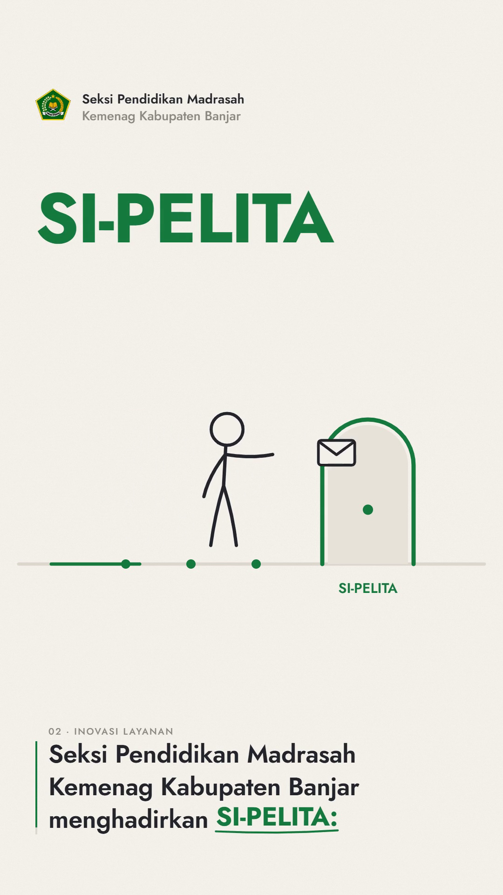
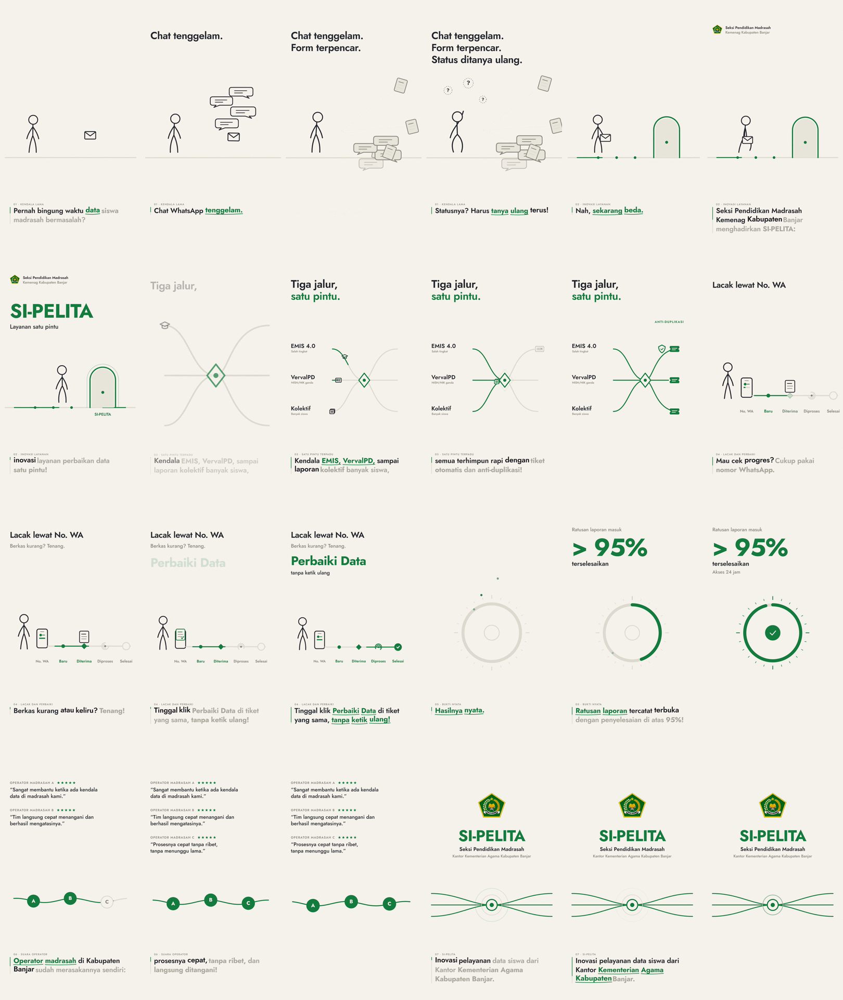

# 01: SI-PELITA Mobile Explainer (9:16)

Video motion graphics vertikal (`1080x1920 @ 60 FPS`) tentang **inovasi pelayanan publik SI-PELITA** (*Sistem Pelaporan Informasi & Data*) dari **Seksi Pendidikan Madrasah, Kantor Kementerian Agama Kabupaten Banjar** dalam menangani laporan kendala data siswa madrasah.





---

## Ringkasan Teknis

| Parameter | Spesifikasi |
| :--- | :--- |
| **Mode Produksi** | Mode B: Lemo-Opuscar (`stick-explainer` hibrida hemat 3 protagonis + bentuk geometris vektor relevan) |
| **Resolusi & FPS** | `1080x1920` (vertikal `9:16`), `60 FPS`, `3.845` frame |
| **Durasi** | `64.083s` |
| **Palet Warna** | Kertas matte `#F4F1EA`, Tinta `#23252C`, Sekunder `#8A877E`, Wire `#DDD8CE`, Aksen tunggal Kemenag Emerald `#157A3D` |
| **Tipografi** | `Jost` Variable Font (OFL) |
| **Voice-Over** | Bahasa Indonesia `id-ID-ArdiNeural` (18 frasa lisan ekspresif bervariasi tempo/pitch + `WordBoundary` per kata) |
| **Audio & Mastering** | Skor orisinal D Mayor `108 BPM` (`kalimba`, `harp`, `nylon_guitar`, `upright_bass_pizz`) + foley event-synced, `-14.0 LUFS`, Peak `-2.0 dBFS` |
| **Subtitle** | Burn-in Kinetic Editorial Subtitles + sidecar `output/sipelita-explainer-9x16.srt` (`18` cue) |

---

## Struktur Dokumentasi & Aset Proyek

- [BRIEF.md](BRIEF.md): kesepakatan brief, fakta terverifikasi aplikasi SI-PELITA, statistik evergreen, dan testimoni anonim.
- [TREATMENT.md](TREATMENT.md): pemilihan struktur, tata bahasa visual, peta beat/musik `108 BPM`, desain subtitle kinetik, naskah 18 frasa, dan audit diferensiasi 6 dimensi.
- [FACTS.md](FACTS.md): rujukan klaim faktual dan statistik publik per `2026-11-20`.
- [REVIEW.md](REVIEW.md): laporan `ffprobe`, `ebur128`, `blackdetect` (`0` segmen gelap), `readcheck.mjs` (exit `0`), inspeksi visual, dan konfirmasi Human QA.
- [CREDITS](CREDITS): lisensi font OFL, aset resmi Kemenag RI, TTS, dan instrumen prosedural lokal.
- Storyboard & Model Sheet: [boards/model-sheet.jpg](boards/model-sheet.jpg) dan [boards/contact-sheet.jpg](boards/contact-sheet.jpg).

---

## Cara Render Ulang Secara Lokal (Windows)

Pastikan prasyarat workspace sudah terpasang (`Node 20+`, `FFmpeg 7+`, Chrome/Playwright, serta `lemo-opuscar/.venv`). Jalankan dari root repositori:

```powershell
# 1. Sintesis VO ekspresif + timestamp per kata & ekspor SRT
lemo-opuscar\.venv\Scripts\python.exe projects\01-sipelita-explainer\scripts\tts_expressive.py
lemo-opuscar\.venv\Scripts\python.exe lemo-opuscar\core\render\srt.py projects\01-sipelita-explainer\voice\cues.json projects\01-sipelita-explainer\voice\subtitles_id.srt

# 2. Ekspor event foley & verifikasi keterbacaan teks layar
$env:PLAYWRIGHT_CHROME = "$env:USERPROFILE\AppData\Local\ms-playwright\chromium-1234\chrome-win64\chrome.exe"
Push-Location lemo-opuscar
node core/render/events.mjs ../projects/01-sipelita-explainer --size 1080x1920 --out ../projects/01-sipelita-explainer/out/events.json
node core/render/readcheck.mjs ../projects/01-sipelita-explainer --size 1080x1920
Pop-Location

# 3. Mix audio VO + musik 108 BPM + foley
lemo-opuscar\.venv\Scripts\python.exe projects\01-sipelita-explainer\mix.py

# 4. Render gambar 60 FPS & mux final ke -14 LUFS
Push-Location lemo-opuscar
node core/render/video.mjs ../projects/01-sipelita-explainer --fps 60 --workers 3 --size 1080x1920 --out ../projects/01-sipelita-explainer/out/video.mp4
& "C:\Program Files\Git\bin\sh.exe" core/render/mux.sh "../projects/01-sipelita-explainer/out/video.mp4" "../projects/01-sipelita-explainer/out/mix.wav" "../projects/01-sipelita-explainer/output/sipelita-explainer-9x16.mp4" 60 0
Pop-Location
```

*(Berkas hasil akhir tersimpan lokal di `projects/01-sipelita-explainer/output/sipelita-explainer-9x16.mp4` dan dikecualikan dari Git melalui `.gitignore`).*
