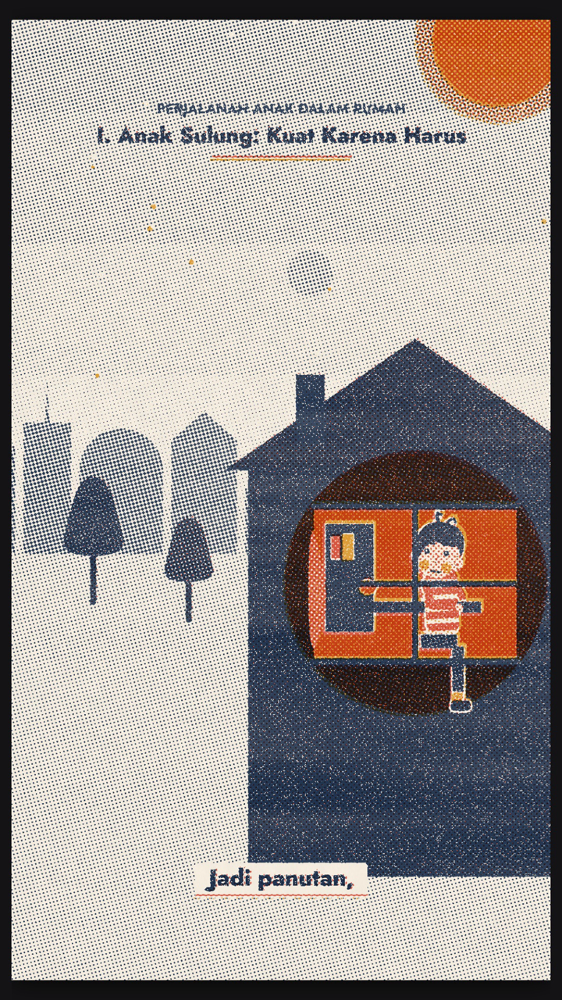
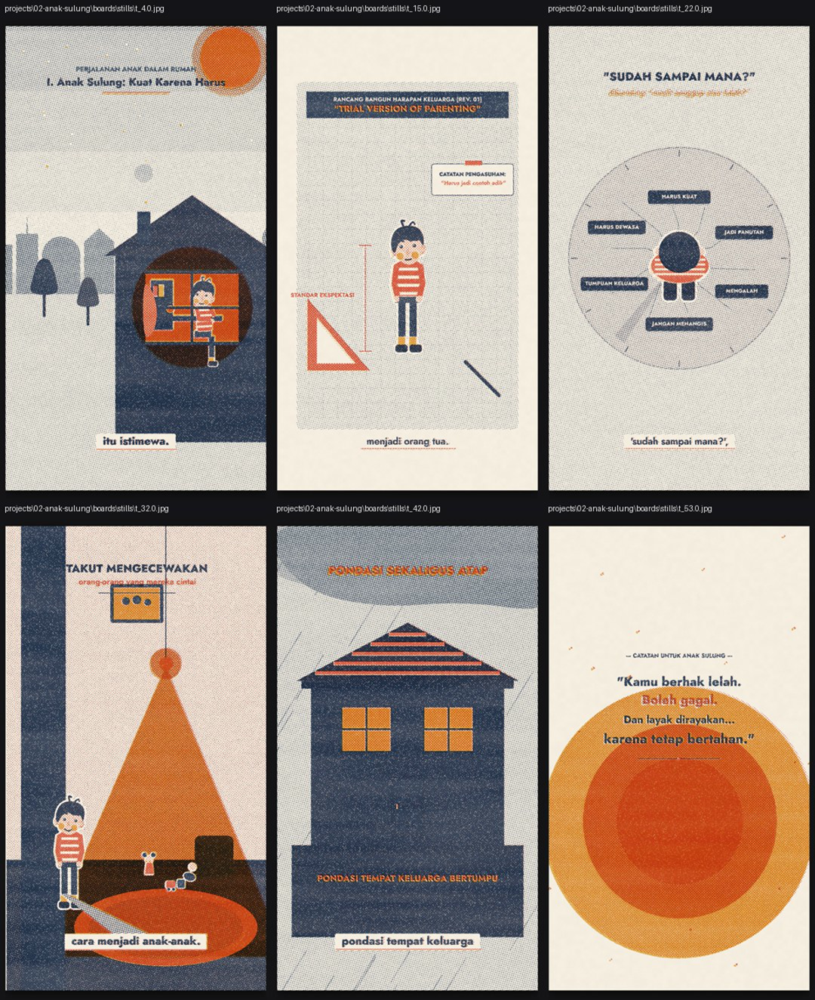

# 02: Perjalanan Anak Dalam Rumah (I) — Anak Sulung: Kuat Karena Harus

> Animasi motion graphics vertikal berelemen seni grafika cetak *Risograph Print* tentang dinamika psikologis, beban ekspektasi, dan keteguhan tak terlihat dari anak sulung, diadaptasi dari esai Medium karya Muhammad Ali Ridho.



## Informasi Produksi

| Atribut | Nilai |
| :--- | :--- |
| **Mode Engine** | Mode B: Lemo-Opuscar Pure (`risograph` — Canvas 2D + WebGL2 Separation Shaders) |
| **Format & FPS** | `1080x1920` (vertikal `9:16`) @ `24 FPS` (1.425 frame) |
| **Durasi Final** | `59.385 detik` |
| **Palet Warna Riso** | Kertas hangat `[246, 239, 226]`, Navy Indigo `[35, 57, 91]`, Terracotta Red `[224, 90, 71]`, Gold `[232, 168, 56]` |
| **Bahasa & Voice-Over** | Bahasa Indonesia `id-ID-ArdiNeural` (ekspresi reflektif, tempo tenang `0.92x`, jeda napas kontemplatif, `WordBoundary` per kata) |
| **Audio & Mastering** | Voice-Over termastering standar siaran: `-14.2 LUFS`, True Peak `-1.4 dBFS`, LRA `3.0 LU` |
| **Subtitle** | Burn-in Kinetic Swiss Editorial Subtitles (2–3 kata per ketukan vokal) + sidecar `output/02-anak-sulung.srt` |
| **Status** | Rendered & Siap Human QA |

---

## Pratinjau Visual (Contact Sheet)



---

## Dokumen Produksi Terkait

- [FACTS.md](FACTS.md) — Fakta, premis, dan struktur esai sumber Medium
- [BRIEF.md](BRIEF.md) — Kesepakatan gaya visual Risograph, rasio 9:16, voice direction, dan durasi target
- [TREATMENT.md](TREATMENT.md) — Peta adegan 6 babak ("Pondasi & Atap Rumah"), naskah lisan, dan tabel adaptasi konteks
- [REVIEW.md](REVIEW.md) — Laporan QA teknis (`readcheck.mjs` 100% PASS, `blackdetect` 0 segmen, `ebur128` `-14.2 LUFS`)

---

## Naskah, Subtitle & Aset

- **Naskah & Timing VO:** [voice/lines.json](voice/lines.json) · [voice/dur.json](voice/dur.json) · [voice/schedule.json](voice/schedule.json) · [voice/words.json](voice/words.json)
- **Subtitle Sidecar:** [voice/subtitles.srt](voice/subtitles.srt)
- **Karakter & Visual Code:** [src/boy.js](src/boy.js) (rig anak laki-laki berkaos garis & tampak atas), [src/environment.js](src/environment.js) (langit bertingkat, atap kota, interior hangat), [src/scenes.js](src/scenes.js) (koreografi 6 adegan), [src/riso.js](src/riso.js) (separasi WebGL2)
- **Tipografi:** `Jost` Variable Font (Open Font License) di [fonts/Jost-Variable.ttf](fonts/Jost-Variable.ttf)

---

## Cara Render Ulang Secara Lokal (Windows)

> Pastikan prasyarat workspace sudah terpasang (`Node 20+`, `FFmpeg 7+`, Chrome/Playwright, serta `lemo-opuscar/.venv`). File `.mp4` dan `.wav`/`.mp3` diabaikan oleh `.gitignore`.

### 1. Sintesis Voice-Over Ekspresif + Timestamp Per Kata & SRT
```powershell
lemo-opuscar\.venv\Scripts\python.exe .agents\skills\motion-studio-workflow\scripts\tts_expressive.py projects\02-anak-sulung
lemo-opuscar\.venv\Scripts\python.exe lemo-opuscar\core\render\srt.py projects\02-anak-sulung\voice\cues.json projects\02-anak-sulung\voice\subtitles.srt
```

### 2. Live Preview Interaktif di Browser
```powershell
node .agents\skills\motion-studio-workflow\scripts\lemo-preview.mjs projects\02-anak-sulung --port 3020
```
Buka browser pada: `http://localhost:3020`

### 3. Audit Keterbacaan Teks Layar (Readcheck)
```powershell
$env:PLAYWRIGHT_CHROME = "C:\Program Files\Google\Chrome\Application\chrome.exe"
node lemo-opuscar\core\render\readcheck.mjs projects\02-anak-sulung --size 1080x1920
```

### 4. Render Video Frames (1.425 frame @ 24 FPS) & Muxing `-14 LUFS`
```powershell
$env:PLAYWRIGHT_CHROME = "C:\Program Files\Google\Chrome\Application\chrome.exe"
node lemo-opuscar\core\render\video.mjs projects\02-anak-sulung --fps 24 --workers 3 --size 1080x1920 --out projects\02-anak-sulung\out\video.mp4

# Mux audio -14 LUFS & kompresi distribusi web/medsos (~15 MB, bitrate ~2.2 Mbps)
ffmpeg -y -i "projects\02-anak-sulung\out\video.mp4" -i "projects\02-anak-sulung\voice\audition.wav" -filter_complex "[1:a]loudnorm=I=-14:LRA=7:TP=-1.5[a]" -map 0:v -map "[a]" -c:v libx264 -preset fast -b:v 2200k -maxrate 3200k -bufsize 4500k -pix_fmt yuv420p -c:a aac -b:a 192k -movflags +faststart -shortest "projects\02-anak-sulung\output\02-anak-sulung.mp4"
```
