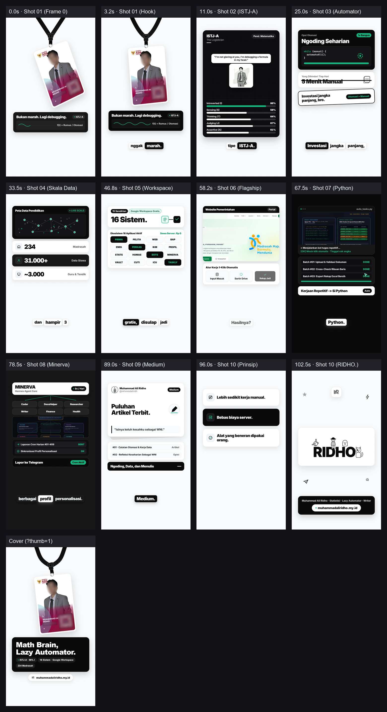

# Muhammad Ali Ridho: Math Brain, Lazy Automator (`03-ridho-intro`)

> Video perkenalan diri *first-person* bergaya *Monochrome Editorial Motion* (`9:16 @ 60 FPS`) untuk portofolio **Muhammad Ali Ridho** (`https://muhammadaliridho.my.id/`) — mengangkat sudut pandang seorang Statistisi lulusan Pendidikan Matematika bertipe `ISTJ-A` yang membangun 16 sistem otomasi di atas Google Workspace gratis, bot Python, sistem 6 agen AI pribadi (*Minerva*), serta puluhan artikel refleksi di Medium.


## Informasi Produksi

| Atribut | Nilai |
| :--- | :--- |
| **Mode Engine** | `Mode A: HyperFrames v0.9.70 (HTML/CSS + GSAP 3.15 + Canvas 2D Verlet Lanyard) + Audio Suite` |
| **Format & FPS** | `1080x1920 (9:16)` @ `60 FPS` |
| **Durasi & Ukuran** | `104.75 detik · 11.88 MB (< 50 MB)` |
| **Bahasa & Voice-Over** | `Bahasa Indonesia Expressive VO (Gemini gemini-3.8-flash-tts · Voice: Orus · Tempo ~0.90x)` |
| **Audio & Mastering** | `VO + Warm Lo-Fi Electric Piano BGM (84 BPM) + Procedural UI SFX via out/mix.wav · -14.1 LUFS · Peak -1.3 dBFS · 48 kHz stereo` |
| **Subtitle** | `Short-Form / Viral Captions (2–3 kata/grup dari voice/words.json, y: 1510px)` + `output/ridho-intro.srt` |
| **Thumbnail** | `output/ridho-intro-thumbnail.jpg (Dedicated Clean Cover via thumbnail.html) + Strong First Frame` |
| **Status** | `Rendered & Human QA Verified` |

## Pratinjau Visual



## Dokumen Terkait

- [FACTS.md](FACTS.md) — Ringkasan fakta terverifikasi dari riset kode sumber web portofolio (`muhammadaliridho.my.id`)
- [BRIEF.md](BRIEF.md) — Kesepakatan Konteks, Gaya Visual, Privasi Instansi, Audio/BGM, Subtitle, Thumbnail, & Mode
- [STORYLINES.md](STORYLINES.md) — Opsi struktur cerita dan penguncian *Opsi 1: The Lazy Automator's Confession* (10 Shot)
- [SPEC.md](SPEC.md) — Spesifikasi angka eksak visual, tipografi, palet warna, *shot list* 104.75 detik, dan daftar `BANNED`
- [REVIEW.md](REVIEW.md) — Hasil audit visual/teknis pra-render (`hyperframes check --json`) dan pasca-render (`ffprobe`, `blackdetect`, `ebur128`, Human QA)

## Naskah, Subtitle & Aset

- **Naskah & Timing VO:** [voice/lines.json](voice/lines.json) · [voice/dur.json](voice/dur.json) · [voice/schedule.json](voice/schedule.json) · [voice/words.json](voice/words.json) · [voice/cues-srt.json](voice/cues-srt.json)
- **Aset Lokal (`assets/`):**
  - `asn-card-front-masked.png` & `asn-card-back-masked.png` — Kartu ID dengan sensor privasi *feathered elliptical Gaussian blur* pada wajah, NIP, dan kode QR.
  - `mbti_character.webp` — Ilustrasi karakter *ISTJ-A The Logistician* dari portofolio pribadi.
  - `siprima-thumb.webp`, `sipelita-thumb.webp`, `penmadbanjar-thumb.webp`, `python-automation-thumb.webp`, `hermes-agent-thumb.webp` — Cuplikan antarmuka proyek dengan *frosted privacy mask* pada identitas instansi.
  - `logo-mar.webp` — Monogram resmi `MAR` (`muhammadaliridho.my.id`).
- **Verifikasi Fakta & Placeholder:** Semua angka (`ISTJ-A 86%/58%/64%/67%/61%`, `234 Madrasah`, `31.000+ Data Siswa`, `~3.000 Guru & Tendik`, `16 Sistem`, `Minerva 6 Agen / 9x Cron`, `Puluhan Artikel Medium`) terverifikasi resmi terhadap `FACTS.md`; placeholder tersisa: tidak ada.

## Cara Render Ulang Secara Lokal (Windows)

> Pastikan prasyarat di [WORKSPACE_CONTEXT.md](../../WORKSPACE_CONTEXT.md) dan root [README.md](../../README.md) sudah terpasang. File `.mp4`, `.wav`/`.mp3`, dan `.env` diabaikan oleh `.gitignore`.

### 1. Sintesis Voice-Over (Gemini TTS Utama / Edge Fallback) & Mix BGM+SFX
```powershell
..\..\lemo-opuscar\.venv\Scripts\python.exe ..\..\.agents\skills\motion-studio-workflow\scripts\tts_expressive.py . --engine auto
..\..\lemo-opuscar\.venv\Scripts\python.exe mix.py
..\..\lemo-opuscar\.venv\Scripts\python.exe ..\..\lemo-opuscar\core\render\srt.py voice\cues-srt.json output\ridho-intro.srt
```

### 2. Audisi Audio & Live Preview Interaktif *(Sebelum Render)*
- **Audio Audition Studio:**
  ```powershell
  node ..\..\.agents\skills\motion-studio-workflow\scripts\lemo-preview.mjs . --port 3020
  ```
  - Audisi suara & lompat per shot: `http://127.0.0.1:3020/audition`
- **Mode A (HyperFrames Quality Gate & Studio Preview):**
  ```powershell
  node ..\..\.agents\skills\hyperframes\scripts\plugin-cli.mjs check --json .
  node ..\..\.agents\skills\hyperframes\scripts\plugin-cli.mjs preview --foreground --port 3030 .
  ```

### 3. Render Final MP4 (`-14 LUFS`, 48 kHz Stereo, `< 50 MB`) & Thumbnail
```powershell
node ..\..\.agents\skills\hyperframes\scripts\plugin-cli.mjs render --fps 60 --quality standard -o out\raw-render.mp4 .
ffmpeg -y -i out\raw-render.mp4 -i out\mix.wav -map 0:v:0 -map 1:a:0 -c:v libx264 -preset medium -crf 19 -maxrate 6000k -bufsize 12000k -pix_fmt yuv420p -c:a aac -b:a 192k -ar 48000 -ac 2 -movflags +faststart output\ridho-intro.mp4
Remove-Item -Force out\raw-render.mp4
```
*(Pastikan hasil akhir `output/ridho-intro.mp4` berukuran `< 50 MB` dan audio ter-resample `48 kHz` stereo; render cover bersih dari `thumbnail.html` ke `output/ridho-intro-thumbnail.jpg` serta salin ke `preview/poster.jpg` dan `preview/contact-sheet.jpg` masing-masing `≤ 400 KB`).*
