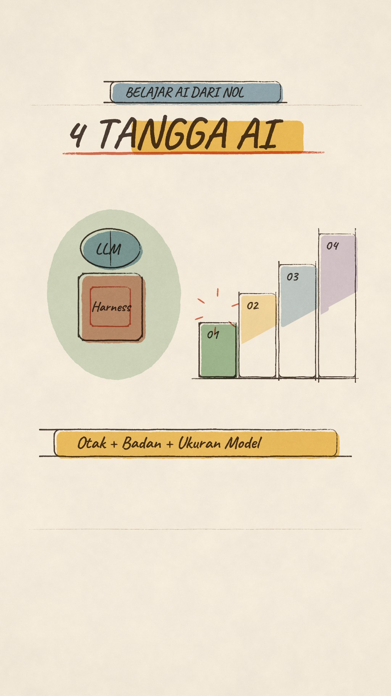
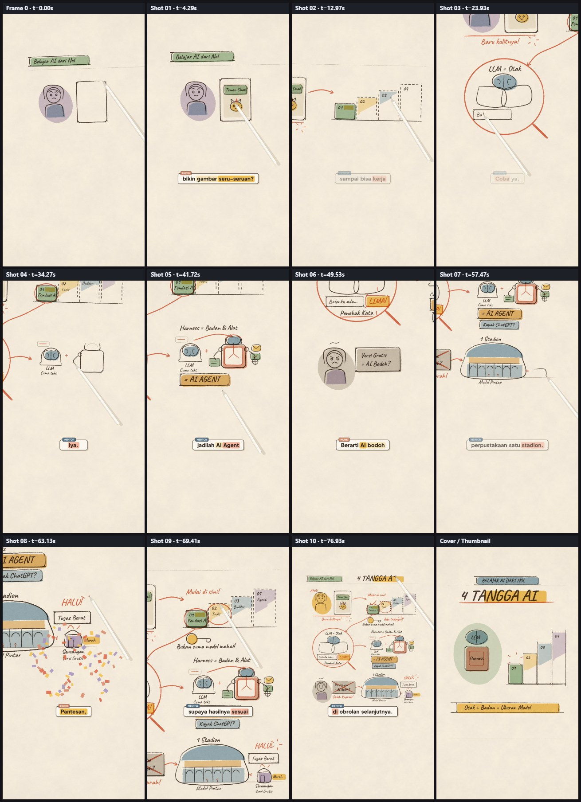

# Belajar AI dari Nol — Part 1: Fundamental AI (`04-bodoh-ke-mahir-ai`)

> Video explainer vertikal *Tablet Sketch* berdurasi `80.0s` mengenai fondasi cara kerja AI (`LLM + Harness = Agent` dan analogi perpustakaan `1 Stadion` vs `Seruangan`) melalui dialog ringan antara Murid dan Mentor.



## Informasi Produksi

| Atribut | Nilai |
| :--- | :--- |
| **Track & Engine** | `Track 1: Lemo-Opuscar (ipad-sketch — Canvas 2D)` |
| **Format & FPS** | `1080x1920 (9:16)` @ `30 FPS` |
| **Durasi & Ukuran** | `80.00 detik · 29.60 MiB (31,043,418 bytes, < 50 MB)` |
| **Bahasa & Voice-Over** | Duet Bahasa Indonesia (`Murid: Kore` + `Mentor: Orus`, Gemini `gemini-3.8-flash-tts` dengan fallback `edge-tts`) |
| **Audio & Mastering** | `VO + BGM Akustik + 312 Event-Synced SFX via out/mix.wav · -14.02 LUFS · Peak -1.10 dBTP · 48 kHz stereo` |
| **Subtitle** | `Short-Form Captions` (zona aman `y: 1196–1290 px`) + `output/04-bodoh-ke-mahir-ai.srt` (`54` cue) |
| **Thumbnail** | `output/04-bodoh-ke-mahir-ai-thumbnail.jpg` (`Dedicated Clean Cover`) + `Strong First Frame` |
| **Privasi & Sensor** | Tokoh umum *Murid* & *Mentor*, bebas data pribadi, sponsor perangkat, maupun promosi eksternal (`0` temuan scan) |
| **Status** | `Rendered & Human QA Verified` |

## Pratinjau Visual



## Dokumen Terkait

- [FACTS.md](FACTS.md) — Ringkasan fakta terverifikasi dari riset bahan
- [BRIEF.md](BRIEF.md) — Kesepakatan Konteks, Gaya Visual, Track Otomatis, Audio/BGM, Subtitle, Thumbnail, & Privasi
- [TREATMENT.md](TREATMENT.md) — Naskah visual, Tabel Adaptasi Konteks `ipad-sketch`, dan 5 *Native Moves*
- [REVIEW.md](REVIEW.md) — Hasil audit otomatis (`studio-audit.mjs --strict`), pemeriksaan font lokal & zona aman `9:16`, serta verifikasi render final

## Naskah, Subtitle & Aset

- **Naskah & Timing VO:** [voice/lines.json](voice/lines.json) · [voice/dur.json](voice/dur.json) · [voice/schedule.json](voice/schedule.json) · [voice/words.json](voice/words.json) · [voice/cues.json](voice/cues.json)
- **Kode Komposisi & Audio:** [index.html](index.html) · [scenes.js](scenes.js) · [events.json](events.json) · [mix.py](mix.py)
- **Aset & Font Lokal (`0` CDN Eksternal):**
  - `assets/fonts/Caveat-Bold.ttf` & `assets/fonts/Caveat-Medium.ttf` *(Google Fonts, lisensi [OFL-caveat.txt](assets/fonts/OFL-caveat.txt))*
  - `assets/fonts/PlusJakartaSans-ExtraBold.ttf` & `assets/fonts/PlusJakartaSans-SemiBold.ttf` *(Google Fonts, lisensi [OFL-pjs.txt](assets/fonts/OFL-pjs.txt))*
  - [assets/glyphs.json](assets/glyphs.json) *(peta goresan huruf pena tablet)*
  - Skor musik akustik & foley dibangkitkan secara prosedural via `lemo-opuscar/core/audio/pluck.py` + `sfx.py` dalam [mix.py](mix.py)
- **Verifikasi Fakta & Placeholder:** Seluruh metrik, durasi, dan aset terverifikasi di `REVIEW.md`; daftar placeholder tersisa: **tidak ada**.

## Cara Render Ulang Secara Lokal (Windows)

> Pastikan prasyarat di [WORKSPACE_CONTEXT.md](../../WORKSPACE_CONTEXT.md) dan root [README.md](../../README.md) sudah terpasang. File `.mp4`, `.wav`/`.mp3`, dan `.env` diabaikan oleh `.gitignore`.

### 1. Sintesis Voice-Over (Gemini TTS Utama + Audio Lock / Edge Fallback), Mix BGM+SFX & SRT
```powershell
..\..\lemo-opuscar\.venv\Scripts\python.exe ..\..\.agents\skills\motion-studio-workflow\scripts\tts_expressive.py . --engine auto
..\..\lemo-opuscar\.venv\Scripts\python.exe mix.py
..\..\lemo-opuscar\.venv\Scripts\python.exe ..\..\lemo-opuscar\core\render\srt.py voice\cues.json output\04-bodoh-ke-mahir-ai.srt
```
*(Gunakan `--reuse-clips` agar vokal lama terkunci, dan `--tempo` bila ingin mengatur kecepatan tanpa mengubah pitch).*

### 2. Audisi Audio, Audit Cepat & Live Preview *(Sebelum Render)*
```powershell
node ..\..\.agents\skills\motion-studio-workflow\scripts\studio-audit.mjs . --thumb --strict
node ..\..\.agents\skills\motion-studio-workflow\scripts\lemo-preview.mjs . --port 3020
```
- Audisi suara & lompat per kalimat: `http://127.0.0.1:3020/audition`
- Live Preview animasi sinkron: `http://127.0.0.1:3020/`

### 3. Render Final MP4 (`-14 LUFS`, 48 kHz Stereo, `< 50 MB`) & Thumbnail
```powershell
$env:PLAYWRIGHT_CHROME = "$env:USERPROFILE\AppData\Local\ms-playwright\chromium_headless_shell-1248\chrome-headless-shell-win64\chrome-headless-shell.exe"
node ..\..\lemo-opuscar\core\render\still.mjs . 0 --q thumb=1 --size 1080x1920 --prefix thumb_ --out out
Move-Item -Force out\thumb_0.jpg output\04-bodoh-ke-mahir-ai-thumbnail.jpg
node ..\..\lemo-opuscar\core\render\video.mjs . --fps 30 --workers 4 --size 1080x1920 --out out\video.mp4
ffmpeg -y -i out\video.mp4 -i out\mix.wav -map 0:v:0 -map 1:a:0 -c:v libx264 -preset slow -crf 20 -maxrate 4500k -bufsize 9000k -pix_fmt yuv420p -c:a aac -b:a 192k -ar 48000 -ac 2 -movflags +faststart -shortest output\04-bodoh-ke-mahir-ai.mp4
Remove-Item -Force out\video.mp4
```
*(Pastikan hasil akhir `output\04-bodoh-ke-mahir-ai.mp4` berukuran `< 50 MB` dengan audio `48 kHz` stereo serta `preview\poster.jpg` dan `preview\contact-sheet.jpg` berukuran `<= 400 KB`).*
