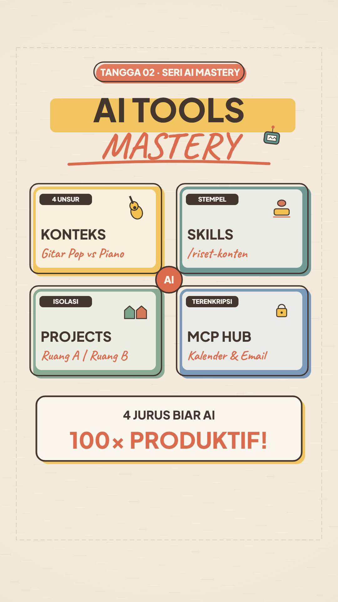
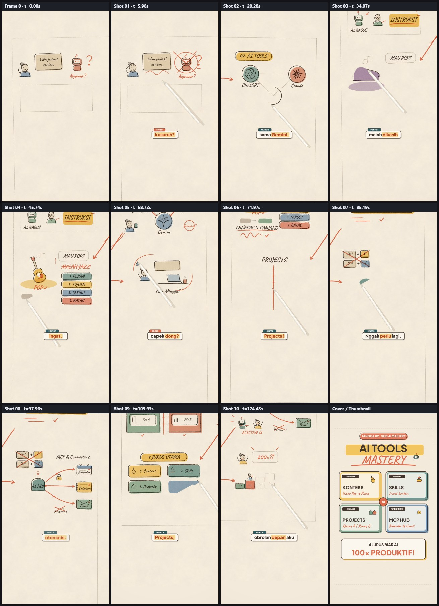

# Belajar AI dari Nol — Part 2: AI Tools Mastery (`05-ai-tools-mastery`)

> Video explainer duet vertikal (`9:16`) untuk pemula dan pekerja umum mengenai cara menguasai alat AI harian (ChatGPT, Claude, Gemini — *AI Trinity*) lewat 4 jurus utama (**Context**, **Skills**, **Projects**, dan **MCP & Connectors**) agar produktivitas kerja meningkat hingga 100 kali lipat.



## Informasi Produksi

| Atribut | Nilai |
| :--- | :--- |
| **Track & Engine** | `Track 1: Lemo-Opuscar (ipad-sketch — Canvas 2D)` |
| **Format & FPS** | `1080x1920 (9:16)` @ `30 FPS` |
| **Durasi & Ukuran** | `133,09 detik · 41,40 MB (< 50 MB)` |
| **Bahasa & Voice-Over** | `Bahasa Indonesia Expressive Duet VO — Gemini gemini-3.8-flash-tts (Murid: Kore · Mentor: Orus)` |
| **Audio & Mastering** | `VO + BGM Akustik G-Major (100 BPM) + 579 Event-Synced Foley SFX via out/mix.wav · -14.0 LUFS · True Peak -1.6 dBFS · 48 kHz stereo` |
| **Subtitle** | `Short-Form / Viral Captions (1–3 kata + Speaker Badge MURID/MENTOR di y: 1184–1286px)` + `output/05-ai-tools-mastery.srt` |
| **Thumbnail** | `output/05-ai-tools-mastery-thumbnail.jpg (Dedicated Clean Cover via ?thumb=1) + Strong First Frame (t=0.00s)` |
| **Watermark** | `Tanpa Watermark` |
| **Privasi & Sensor** | `100% generik (hanya karakter Murid & Mentor serta contoh tugas kerja umum; 0 nama kreator/sponsor/komunitas/proyek pribadi)` |
| **Status** | `Rendered & Human QA Verified` |

## Pratinjau Visual



## Dokumen Terkait

- [FACTS.md](FACTS.md) — Ringkasan fakta terverifikasi dari riset bahan Tangga 02 (*AI Tools Mastery*)
- [BRIEF.md](BRIEF.md) — Kesepakatan Konteks, Gaya Visual, Track Otomatis, Audio/BGM, Subtitle, Thumbnail, Watermark, & Privasi
- [TREATMENT.md](TREATMENT.md) — *Director Treatment* Track 1 (`ipad-sketch`), Tabel Adaptasi Konteks Anti-Jipling, & 5 *Native Moves*
- [REVIEW.md](REVIEW.md) — Hasil audit otomatis (`studio-audit.mjs --strict --thumb`), verifikasi font lokal, zona aman `9:16`, `ffprobe`/`blackdetect`/`ebur128`, serta Human QA

## Naskah, Subtitle & Aset

- **Naskah & Timing VO:** [voice/lines.json](voice/lines.json) · [voice/schedule.json](voice/schedule.json) · [voice/words.json](voice/words.json) · [voice/cues.json](voice/cues.json)
- **Kode Ilustrasi & Animasi:** [index.html](index.html) · [art.js](art.js) · [scenes.js](scenes.js) · [glyphs.json](glyphs.json) · [events.json](events.json) · [mix.py](mix.py)
- **Aset & Font Lokal (`assets/fonts/`):** `Caveat-Bold.ttf`, `Caveat-Medium.ttf` ([OFL-caveat.txt](assets/fonts/OFL-caveat.txt)), `PlusJakartaSans-ExtraBold.ttf`, `PlusJakartaSans-SemiBold.ttf` ([OFL-pjs.txt](assets/fonts/OFL-pjs.txt))
- **Verifikasi Fakta & Placeholder:** Semua angka, istilah teknis, dan aset terverifikasi resmi; daftar placeholder tersisa: tidak ada.

## Cara Render Ulang Secara Lokal (Windows)

> Pastikan prasyarat di [WORKSPACE_CONTEXT.md](../../WORKSPACE_CONTEXT.md) dan root [README.md](../../README.md) sudah terpasang. File `.mp4`, `.wav`/`.mp3`, `boards/`, dan `.env` diabaikan oleh `.gitignore`.

### 1. Sintesis Voice-Over (Gemini TTS Utama + Audio Lock / Edge Fallback), Export Event & Mix BGM+SFX
```powershell
..\..\lemo-opuscar\.venv\Scripts\python.exe ..\..\.agents\skills\motion-studio-workflow\scripts\tts_expressive.py . --engine auto --reuse-clips
$env:PLAYWRIGHT_CHROME = (Get-ChildItem "$env:USERPROFILE\AppData\Local\ms-playwright" -Recurse -Include chrome-headless-shell.exe,chrome.exe | Sort-Object FullName -Descending | Select-Object -First 1 -ExpandProperty FullName)
node ..\..\lemo-opuscar\core\render\events.mjs . --size 1080x1920
..\..\lemo-opuscar\.venv\Scripts\python.exe mix.py
..\..\lemo-opuscar\.venv\Scripts\python.exe ..\..\lemo-opuscar\core\render\srt.py voice\cues.json output\05-ai-tools-mastery.srt
```

### 2. Audisi Audio, Audit Cepat & Live Preview *(Sebelum Render)*
```powershell
$env:PLAYWRIGHT_CHROME = (Get-ChildItem "$env:USERPROFILE\AppData\Local\ms-playwright" -Recurse -Include chrome-headless-shell.exe,chrome.exe | Sort-Object FullName -Descending | Select-Object -First 1 -ExpandProperty FullName)
node ..\..\.agents\skills\motion-studio-workflow\scripts\studio-audit.mjs . --strict --thumb
node ..\..\.agents\skills\motion-studio-workflow\scripts\lemo-preview.mjs . --port 3020
```
- Audisi suara & lompat per kalimat: `http://127.0.0.1:3020/audition`
- Live Preview animasi sinkron: `http://127.0.0.1:3020/`

### 3. Render Final MP4 (`-14 LUFS`, 48 kHz Stereo, `< 50 MB`) & Thumbnail
```powershell
$env:PLAYWRIGHT_CHROME = (Get-ChildItem "$env:USERPROFILE\AppData\Local\ms-playwright" -Recurse -Include chrome-headless-shell.exe,chrome.exe | Sort-Object FullName -Descending | Select-Object -First 1 -ExpandProperty FullName)
node ..\..\lemo-opuscar\core\render\still.mjs . 0 --q "thumb=1" --prefix "thumb_" --out output --size 1080x1920
Move-Item -Path "output\thumb_0.jpg" -Destination "output\05-ai-tools-mastery-thumbnail.jpg" -Force
node ..\..\lemo-opuscar\core\render\video.mjs . --fps 30 --workers 4 --size 1080x1920 --out out\video.mp4
ffmpeg -y -i out\video.mp4 -i out\mix.wav -vf "scale=in_range=full:out_range=tv,format=yuv420p" -color_range tv -colorspace bt709 -c:v libx264 -preset slow -crf 20 -maxrate 4500k -bufsize 9000k -c:a aac -ar 48000 -ac 2 -b:a 192k -movflags +faststart -shortest output\05-ai-tools-mastery.mp4
Remove-Item -Force out\video.mp4
```
