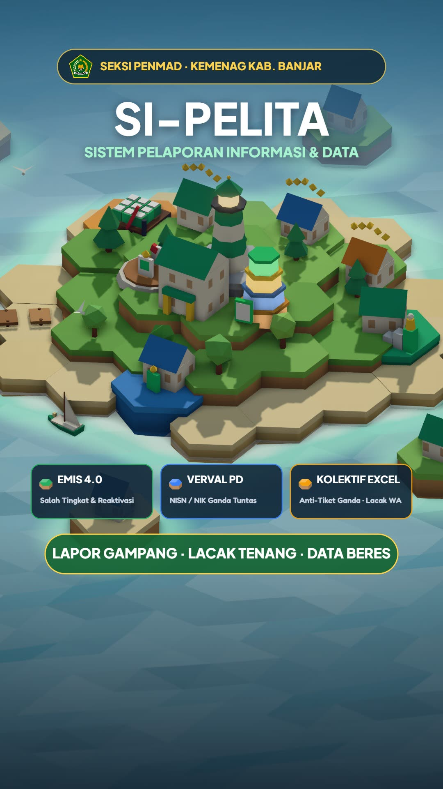
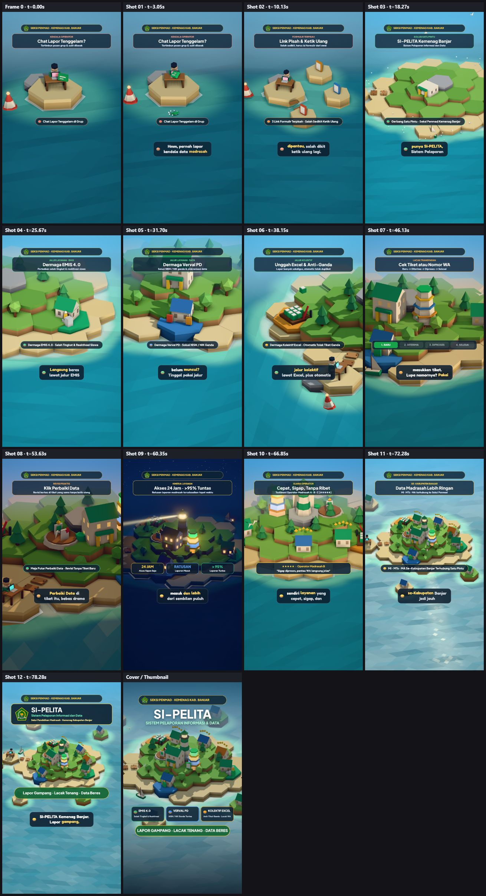

# 06 - SI-PELITA: Sistem Pelaporan Informasi dan Data (Low-Poly Isometric Island 3D Explainer)

Video explainer publik format vertikal (`9:16` · `1080x1920 @ 30 FPS`) untuk inovasi layanan **SI-PELITA** (*Sistem Pelaporan Informasi dan Data*) pada **Seksi Pendidikan Madrasah, Kantor Kementerian Agama Kabupaten Banjar**.

Proyek ini dibangun menggunakan **Track 1 (Lemo-Opuscar WebGL)** dengan gaya visual **`lowpoly-island`** (*Low-poly Isometric Island*): kamera ortografis Three.js (`THREE.OrthographicCamera`), pulau prisma heksagonal *flat-shaded* yang tumbuh berirama dari laut, gelombang air vertex non-indexed (`sea.js`) dengan gradasi laguna dangkal (*shallow-water shoreline*), pencahayaan matahari terarah + siklus transisi malam (`s09`) lengkap dengan sorot volumetrik mercusuar 24 jam, serta *post-processing* `GTAOPass`, *miniature tilt-shift blur*, dan `UnrealBloomPass` (`post.js`).



---

## Ringkasan Proyek

| Parameter | Spesifikasi |
| :--- | :--- |
| **Slug Proyek** | `06-sipelita-explainer-v2` |
| **Instansi / Inovasi** | Seksi Pendidikan Madrasah, Kantor Kementerian Agama Kabupaten Banjar · **SI-PELITA** |
| **Track & Gaya Visual** | Track 1 (`Lemo-Opuscar` Three.js WebGL) · Gaya `lowpoly-island` (*Low-poly Isometric Island*) |
| **Resolusi & Frame Rate** | `1080x1920` (`9:16` Vertikal) @ `30 FPS` (`2.456 frame`) |
| **Durasi Total** | `81.85 detik` (`12 shot`, `s01` s.d. `s12`) |
| **Voice-Over** | Gemini TTS (`gemini-3.8-flash-tts`, suara `Orus`), sudut pandang sesama operator madrasah yang santai dengan humor ringan dan ad-lib natural |
| **Musik & Foley** | Sintesis *2-phase event-driven* (`mix.py` + `events.json` `112` event 3D): marimba, kalimba, celesta, woodblock, *warm low-passed pad*, shaker lembut, dan *muted kick* `54 Hz` (tanpa piano/strings) |
| **Target Loudness** | **`-13.6 LUFS`** Integrated (`ebur128`, target `-13.0` s.d. `-15.0 LUFS`) · True Peak **`-3.0 dBFS`** (`<= -1.0 dBFS`) |
| **Output Utama (Lokal)** | `output/06-sipelita-explainer-v2.mp4` (`40.17 MB`, H.264 TV-range `yuv420p`) · `output/06-sipelita-explainer-v2-thumbnail.jpg` · `output/06-sipelita-explainer-v2.srt` (`28` blok subtitle) |

---

## Alur Cerita & Koreografi 12 Adegan (`story.js` & `world.js`)

| Shot | Waktu (`s`) | Bab / Judul | Koreografi 3D Low-Poly Island |
| :---: | :---: | :--- | :--- |
| `s01` | `0.00 .. 6.23` | **Realita Operator** | Pulau meja kerja operator madrasah dengan laptop menyala; kubus pesan chat menumpuk di sekitar meja lalu tenggelam ke laut satu per satu. |
| `s02` | `6.23 .. 14.33` | **Tiga Form Terpisah** | Tiga pulau formulir lama muncul terpisah tanpa jembatan disertai blok peringatan merah *Input Ulang Data*. |
| `s03` | `14.33 .. 22.58` | **Hadirnya SI-PELITA** | Pulau pusat heksagonal **SI-PELITA** tumbuh di tengah laguna disertai gedung layanan Satu Pintu dan jembatan kayu penghubung. |
| `s04` | `22.58 .. 29.08` | **Jalur 1: EMIS 4.0** | Dermaga Timur (*Emerald Green*) muncul melayani kendala *Siswa Salah Tingkat* dan *Reaktivasi EMIS*. |
| `s05` | `29.08 .. 34.58` | **Jalur 2: Verval PD** | Dermaga Selatan (*Royal Blue*) muncul dengan gerbang pemindai *NISN & NIK Ganda* yang menyatukan dua keping identitas siswa. |
| `s06` | `34.58 .. 42.02` | **Jalur 3: Kolektif Excel** | Dermaga Barat (*Amber Gold & Mint*) mengangkut kontainer laporan kolektif `.xlsx`/`.xls`; sistem **Anti-Tiket Ganda** memantulkan duplikat merah ke laut. |
| `s07` | `42.02 .. 50.59` | **Lacak Status & WhatsApp** | Menara lacak 4 tingkat (`Baru -> Diterima -> Diproses -> Selesai`) menyala berurutan dari pencarian nomor tiket atau nomor WhatsApp pengaju. |
| `s08` | `50.59 .. 57.02` | **Fitur Perbaiki Data** | Meja putar mekanis (*turntable*) di sisi menara memutar dokumen *Perlu Revisi* dan mengubahnya menjadi keping hijau terverifikasi tanpa membuat tiket baru. |
| `s09` | `57.02 .. 64.02` | **Akses 24 Jam & Transparansi** | Siklus langit berubah ke malam berbintang; mercusuar **SI-PELITA** memutar sorot cahaya volumetrik di atas laut (`Akses 24 Jam · > 95% Tuntas`). |
| `s10` | `64.02 .. 70.02` | **Suara Rekan Operator** | Fajar menyingsing; tiga monumen prasasti bintang 5 muncul untuk `Operator Madrasah A`, `Operator Madrasah B`, dan `Operator Madrasah C`. |
| `s11` | `70.02 .. 74.88` | **Kepulauan Madrasah Terhubung** | Kamera menarik mundur memperlihatkan gugusan pulau madrasah se-Kabupaten Banjar yang terhubung jembatan ke pulau utama. |
| `s12` | `74.88 .. 81.85` | **Kartu Penutup Resmi** | Kamera naik ke sudut pandang burung (*bird's-eye overview*) menampilkan kartu penutup resmi **Seksi Pendidikan Madrasah · Kemenag Kab. Banjar**. |



---

## Struktur Direktori

```text
projects/06-sipelita-explainer-v2/
├── FACTS.md                     # Fakta terverifikasi & aturan privasi ketat (100% anonim)
├── BRIEF.md                     # Brief kreatif yang dikunci bersama pemilik proyek
├── TREATMENT.md                 # Arah penyutradaraan, palet warna, kamera, dan koreografi
├── REVIEW.md                    # Laporan audit otomatis studio-audit.mjs & verifikasi teknis MP4
├── README.md                    # Dokumentasi proyek & panduan reproduksi
├── index.html                   # Entrypoint WebGL + HUD + Creative Stylized Subtitles + ?thumb=1
├── main.js                      # Orkestrator timeline deterministik, proyeksi 3D-ke-2D, & subtitle
├── world.js                     # Pemodelan prosedural pulau heksagonal, karakter, dermaga, & mercusuar
├── sea.js                       # Shader laut low-poly non-indexed & laguna dangkal dinamis
├── post.js                      # Pipeline GTAO, langit/bintang malam, tilt-shift DOF, & bloom
├── story.js                     # Definisi 12 shot, keyframe kamera ortografis, & palet warna
├── events.json                  # 112 event animasi 3D untuk sinkronisasi foley 1:1
├── mix.py                       # Generator BGM marimba/kalimba, 2-tier foley, & pengekspor .srt
├── assets/
│   └── logo-kemenag.png         # Logo resmi Kementerian Agama RI (aset lokal)
├── fonts/
│   ├── fonts.css                # Deklarasi @font-face lokal (100% offline)
│   ├── Jost-Variable.ttf
│   ├── PlusJakartaSans-SemiBold.ttf
│   ├── PlusJakartaSans-ExtraBold.ttf
│   └── f3.woff2
├── preview/
│   ├── poster.jpg               # Poster thumbnail terkompresi untuk GitHub (<= 400 KB)
│   └── contact-sheet.jpg        # Lembar kontak 14 panel audit visual untuk GitHub (<= 400 KB)
└── voice/
    ├── lines.json               # Naskah 12 segmen narasi Bahasa Indonesia
    ├── dur.json                 # Durasi tiap segmen audio
    ├── schedule.json            # Jadwal penempatan VO & batas 12 shot
    ├── words.json               # Timestamp per kata untuk Creative Stylized Subtitles & SRT
    └── cues.json                # Penanda frase subtitle
```

*(File biner berukuran besar seperti `output/*.mp4`, `out/mix.wav`, `voice/wav/*.wav`, `voice/audition.wav`, dan `boards/*.jpg` dikecualikan dari Git melalui `.gitignore`).*

---

## Panduan Reproduksi Lokal (Windows PowerShell)

Jalankan perintah berikut dari **root workspace** (`AI-Motion-Studio`):

### 1. Live Preview & Audisi Audio di Browser
```powershell
node .agents\skills\motion-studio-workflow\scripts\lemo-preview.mjs projects\06-sipelita-explainer-v2 --port 3020
```
Buka `http://127.0.0.1:3020` untuk memutar animasi WebGL beserta audio, atau `http://127.0.0.1:3020/?t=58.5` untuk melompat ke detik tertentu, atau `http://127.0.0.1:3020/?t=72.5&thumb=1` untuk melihat mode *Dedicated Cover Thumbnail*.

### 2. Ekspor Event 3D (`events.json`) & Sintesis Audio Mix (`out/mix.wav` + `.srt`)
```powershell
$env:PLAYWRIGHT_CHROME = (Get-ChildItem "$env:USERPROFILE\AppData\Local\ms-playwright" -Recurse -Include chrome-headless-shell.exe,chrome.exe | Sort-Object FullName -Descending | Select-Object -First 1 -ExpandProperty FullName)
node lemo-opuscar\core\render\events.mjs projects\06-sipelita-explainer-v2
lemo-opuscar\.venv\Scripts\python.exe projects\06-sipelita-explainer-v2\mix.py
```

### 3. Audit Visual Otomatis (`studio-audit.mjs --strict --thumb`)
```powershell
node .agents\skills\motion-studio-workflow\scripts\studio-audit.mjs projects\06-sipelita-explainer-v2 --strict --thumb
```

### 4. Render Dedicated Cover Thumbnail (`1080x1920`)
```powershell
$env:PLAYWRIGHT_CHROME = (Get-ChildItem "$env:USERPROFILE\AppData\Local\ms-playwright" -Recurse -Include chrome-headless-shell.exe,chrome.exe | Sort-Object FullName -Descending | Select-Object -First 1 -ExpandProperty FullName)
node lemo-opuscar\core\render\still.mjs projects\06-sipelita-explainer-v2 72.5 --q thumb=1 --prefix thumb_ --out projects\06-sipelita-explainer-v2\output --size 1080x1920
Move-Item -Force projects\06-sipelita-explainer-v2\output\thumb_72.5.jpg projects\06-sipelita-explainer-v2\output\06-sipelita-explainer-v2-thumbnail.jpg
```

### 5. Render Video Final (`1080x1920 @ 30 FPS`, TV-Range `yuv420p`, `< 50 MB`)
```powershell
$env:PLAYWRIGHT_CHROME = (Get-ChildItem "$env:USERPROFILE\AppData\Local\ms-playwright" -Recurse -Include chrome-headless-shell.exe,chrome.exe | Sort-Object FullName -Descending | Select-Object -First 1 -ExpandProperty FullName)
node lemo-opuscar\core\render\video.mjs projects\06-sipelita-explainer-v2 --fps 30 --workers 3 --size 1080x1920 --out projects\06-sipelita-explainer-v2\out\video.mp4
ffmpeg -y -i projects\06-sipelita-explainer-v2\out\video.mp4 -i projects\06-sipelita-explainer-v2\out\mix.wav -map 0:v:0 -map 1:a:0 -vf "scale=in_range=full:out_range=tv,format=yuv420p" -color_range tv -colorspace bt709 -c:v libx264 -preset medium -crf 19 -maxrate 6000k -bufsize 12000k -c:a aac -b:a 192k -ar 48000 -ac 2 -movflags +faststart projects\06-sipelita-explainer-v2\output\06-sipelita-explainer-v2.mp4
Remove-Item -Force projects\06-sipelita-explainer-v2\out\video.mp4
```
